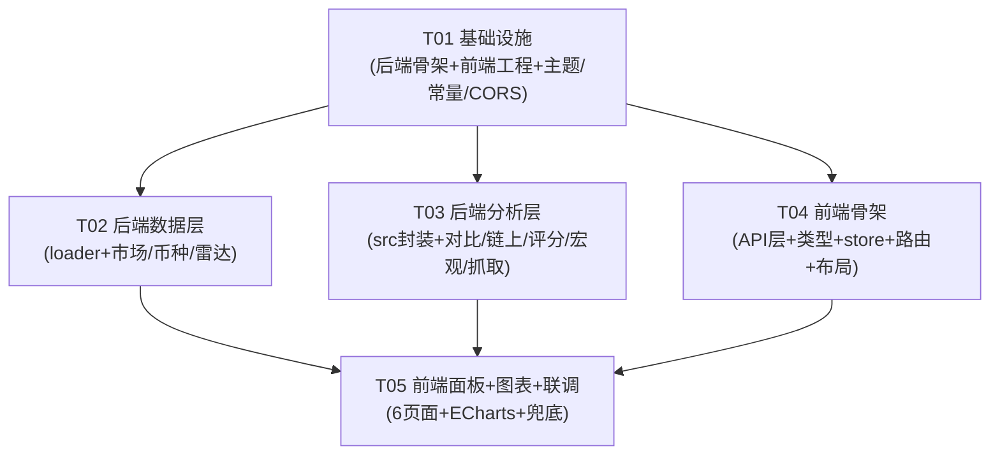

# claude_trading 投研控制台 — 系统架构设计（实现后修订版）

> **文档类型**：架构设计 + 实现现状（Architecture & As-built）
> **作者**：高见远（架构师）｜**实现后修订**：架构组（2026-09-27 复核）
> **面向**：工程师（实现依据与回归基线）
> **技术栈**：后端 FastAPI（Python 3.10+）｜前端 Vite + React + MUI + ECharts
> **版本**：v0.2（v0.1 为设计初稿；v0.2 按实际交付重写文件清单/接口/公式/依赖，并补 §10 缺陷修复记录）

> 修订原则：**本文档描述已落地的实现，而非设计意图**。凡与代码不一致处以代码为准并回写本文档；PRD 的原始需求文本另在 `PRD.md` §6 做交付对照，不改写历史规格。

---

## 0. 设计摘要

- **架构一句话**：全栈投研控制台——FastAPI 后端复用 `src/` 既有分析模块（web_research / chain / scorer / advice / btc_dominance / comparison）+ 读取本地 `daily_scan` 数据，React 前端以 ECharts 深色科技风渲染 6 面板。
- **后端路由**：**10 个端点**（E1 health / E2 meta / E3 市场总览 / E4 币种档案 / E5 机会雷达 / E6 竞品对比 / E7 链上分析 / E8 评分建议 / E9 BTC 占比 / E10 实时抓取）。E1–E5 纯本地零网络；E6–E10 触网并全部 best-effort 容错。
- **前端页面**：6 个面板 + 1 个全局布局/导航 + 共享图表/状态层；图表统一用 **ECharts（echarts-for-react）**，MUI 负责布局/组件/主题。
- **任务总数**：5 个（T01 基础设施 → T02 后端数据层 → T03 后端分析层 → T04 前端骨架 → T05 前端面板与联调），均已交付（见 §7）。
- **关键选型**：ECharts 雷达/柱状（与看板风格一致）、Vite dev proxy `/api`→`localhost:8000`、统一响应信封 `{code,message,data}`、红涨绿跌（`#f6465d`/`#2ebd85`）。
- **应用目录**：`console/backend/`（FastAPI）+ `console/frontend/`（Vite React），后端把项目根注入 `sys.path` 以 `import src`。

---

## 1. 实现方案

### 1.1 技术难点与选型

| 难点 | 方案 | 选型理由 |
|------|------|----------|
| 本地海量 JSON 读取 | 自研 `data/loader.py` | 复用 `build_dashboard.collect_dashboard_data` 的数据口径，集中封装 `daily_scan` 读取、最新日期解析、缺失兜底；不引入 ORM / pandas |
| 复用 `src/` 复杂分析模块（多依赖网络） | 薄服务封装层（Services） | 直接 `import src.*`，用 try/except 封装；失败返回空结构而非 500，保证首屏可用 |
| 深色科技风 + 多面板导航 | MUI + `theme.ts` 集中 token | MUI 负责布局/主题/组件；颜色 token 集中在 `src/theme.ts` 的 `COLORS`/`ECHARTS_DARK`，组件内禁止裸 hex（唯一例外 `index.css`） |
| 雷达图 / 分布图 / 热力图 | **ECharts（echarts-for-react）** | 与 `build_dashboard` 看板风格一致；雷达图契合「百倍币多维评分」与「链上 8 维」 |
| 前后端本地联调 | Vite dev proxy | `vite.config.ts` 把 `/api` 代理到 `http://localhost:8000`，前端无需硬编码地址；prod 用 CORS 白名单 |
| 实时抓取（web_research）长耗时、可能失败 | 同步触发 + 前端 loading + 后端线程超时兜底 | 面向本地单人；`POST /api/tokens/{id}/research` 在守护线程中执行并 25s 超时，超时/失败返回离线基线 + message |
| 分析端点极慢（实测 23–149s）会阻塞并发 | **路由处理器一律同步 `def`** | Starlette 把同步 handler 放入线程池；`async def` 会占住事件循环，使首屏 3 个并发请求退化为串行（见 §10 缺陷 2） |

### 1.2 架构模式

- **后端**：分层 = `Routers`（HTTP） → `Services`（业务 / 复用 src） → `DataLoader`（本地 IO）。所有响应走统一信封。
- **前端**：组件化 + react-router + 轻量全局状态（React Context，**仅存数据日期 `date`**）。API 请求层集中在 `api/client.ts`。
- **数据流向**：前端 `api/client` → Router → Service →（本地文件 OR `src` 模块）→ Pydantic 响应模型 → JSON 信封 → 前端 TS 类型 → ECharts/MUI 渲染。

### 1.3 本地联调

- 后端：`cd console/backend && uvicorn main:app --port 8000 --reload`（`core.paths` 注入项目根，故可 `import src`）。
- 前端：`npm run dev`（Vite 5173），`vite.config.ts` 中 `server.proxy['/api'] = http://localhost:8000`。
- 联调验证：`GET http://localhost:5173/api/market/overview` 应经代理命中后端；`http://localhost:8000/docs` 可访问 OpenAPI。

---

## 2. 文件清单（as-built）

### 2.1 后端 `console/backend/`

```
console/backend/
├── requirements.txt          # fastapi / uvicorn / pydantic / requests / beautifulsoup4 / lxml
├── main.py                   # FastAPI app：CORS、路由挂载、全局异常→信封、同步 handler 约定
├── run.sh                    # 装依赖 + 起 uvicorn
├── core/
│   ├── config.py             # CORS_ORIGINS / APP_NAME / APP_VERSION / WEB_RESEARCH_TIMEOUT / RADAR_WEIGHTS / RADAR_MCAP_CAP
│   ├── envelope.py           # success() / failure() / EnvelopeResponse
│   └── paths.py              # PROJECT_ROOT（+sys.path 注入）、DAILY_SCAN_DIR、resolve_scan_date()、list_scan_dates()
├── data/
│   ├── loader.py             # load_summary / load_all_coins / load_by_category_raw / load_deep_raw / find_coin_raw
│   └── schemas.py            # CoinBrief, NewsItem, SectorStat, MarketOverviewResponse, OpportunityItem/Response,
│                             # TokenDetailResponse, WebResearchResponse, ComparisonProject/Response,
│                             # OnchainResponse, ScoreResponse, MacroResponse, MetaResponse, HealthResponse
├── services/
│   ├── common.py             # coin_brief_from_light / coin_brief_from_market
│   ├── market_svc.py         # build_meta / build_overview / build_sectors（纯本地）
│   ├── token_svc.py          # build_detail（离线基线）
│   ├── opportunity_svc.py    # compute（5 维启发式打分）
│   ├── chain_svc.py          # analyze → src.chain.orchestrator
│   ├── score_svc.py          # score → src.analysis.scorer + advice
│   ├── compare_svc.py        # compare → src.analysis.comparison
│   ├── macro_svc.py          # btc_dominance → src.analysis.btc_dominance
│   └── web_research_svc.py   # research（线程 + 25s 超时）→ src.research.web_research
├── routers/                  # meta / market / tokens / opportunity / compare / chain / scores / macro / research
└── tests/                    # conftest + test_envelope / test_loader / test_opportunity / test_score_svc / test_routers
```

### 2.2 前端 `console/frontend/`

```
console/frontend/
├── package.json              # react / react-dom / react-router-dom / @mui/material / @emotion/* / echarts / echarts-for-react / axios
│                             # devDeps: vite / @vitejs/plugin-react / typescript / @types/react(-dom)
├── vite.config.ts            # /api 代理到 :8000，outDir=dist
├── tsconfig.json / tsconfig.node.json
├── index.html
└── src/
    ├── main.tsx              # React 入口（ThemeProvider + CssBaseline + App）
    ├── App.tsx               # BrowserRouter + AppLayout + ErrorBoundary + 路由出口
    ├── router.tsx            # 路由表（6 面板 + /scores/:id + 通配重定向）
    ├── theme.ts              # COLORS / ECHARTS_DARK / MUI 深色主题
    ├── index.css             # 全局底色与滚动条（唯一允许裸 hex 处）
    ├── api/
    │   ├── client.ts         # axios 实例 + 信封解包拦截器 + 按端点超时预算
    │   └── endpoints.ts      # 端点路径常量（含 /api 前缀）
    ├── types/models.ts       # TS 类型（与后端 Pydantic 对应）
    ├── store/useAppStore.tsx  # 全局状态：仅 date（持久化 localStorage）
    ├── layout/
    │   ├── AppLayout.tsx     # 顶部导航 + 内容区 + 底部强制免责声明
    │   └── NavBar.tsx        # Logo + 6 Tab + 全局日期选择器
    ├── components/
    │   ├── common/           # Card / EmptyState / ErrorBoundary / Loading / PageHeader / RiskDisclaimer
    │   └── charts/           # EChart / RadarChart / BarChart / KpiCard / HeatMap
    ├── utils/format.ts       # fmtMcap / fmtPct / fmtNum / fmtPrice / colorForChange（红涨绿跌）
    └── pages/                # MarketOverview / TokenProfile / Comparison / Onchain / ScoresAdvice / HundredXRadar
```

---

## 3. 数据结构与接口

> 完整类图见 `class-diagram.mermaid`。

### 3.1 统一响应信封

```jsonc
{ "code": 0, "message": "ok", "data": { ... } }
// code: 0=成功; 400=入参非法; 404=数据/币种不存在（返回 data=空结构）;
//       503=分析类端点失败（网络受限/超时，返回 data=空结构）; 500=未捕获异常（经全局处理器转信封，HTTP 仍 200）
```

未匹配路由由框架直接返回 HTTP 404 `{"detail":"Not Found"}`，不走信封（预期行为）。

### 3.2 API 端点清单

| # | 方法 | 路径 | 入参 | 返回 `data` | 数据来源 |
|---|------|------|------|-------------|----------|
| E1 | GET | `/api/health` | — | `{status,version,dataDate}` | 本地（运维探活） |
| E2 | GET | `/api/meta` | — | `{date,scanTime,deepTotal,lightTotal,coinCnt,availableDates,weights}` | 本地 |
| E3 | GET | `/api/market/overview` | `?date=` | `MarketOverviewResponse` | `summary.json`+`top_800_light`+`by_category` |
| E4 | GET | `/api/tokens/{id}` | `?date=` | `TokenDetailResponse` | `top_50_detailed/*`、`by_category/*` |
| E5 | GET | `/api/opportunity/radar` | `?date=&mcapMax=&sort=` | `OpportunityRadarResponse` | `top_800_light`+`top_50_detailed`+`by_category` |
| E6 | POST | `/api/comparison` | body `["id1","id2",...]`（2–5） | `ComparisonResponse` | `src.analysis.comparison`（网络） |
| E7 | GET | `/api/onchain` | `?chain=&query=&demo=` | `OnchainResponse` | `src.chain.orchestrator.analyze`（网络 / demo） |
| E8 | GET | `/api/score/{id}` | — | `ScoreResponse` | `src.analysis.scorer`+`advice`（网络） |
| E9 | GET | `/api/macro/btc-dominance` | — | `MacroResponse` | `src.analysis.btc_dominance`（网络） |
| E10 | POST | `/api/tokens/{id}/research` | 无 body | `WebResearchResponse` | `src.research.web_research`（网络，25s 超时兜底） |

> **E1–E5 纯本地零网络**；E6–E10 调用 `src` 模块可能触网，service 层**全部 try/except 包裹**，失败返回 `data`=空结构 + `message`。
> 已移除：`/api/sectors`（数据已在 `overview.sectors`）、`/api/tokens` 列表端点（前端无消费者）。

### 3.3 关键 Pydantic 响应模型（与 `data/schemas.py` 一致）

```python
class CoinBrief(BaseModel):
    id: str; sym: str|None; name: str|None; rank: int|None
    price: float|None; mcap: float|None; vol: float|None
    chg24: float = 0; chg7d: float = 0

class NewsItem(BaseModel):
    title: str|None; url: str|None; source: str|None; date: str|None; kind: str|None

class SectorStat(BaseModel):
    cat: str; count: int; mcap: float|None; avgChg: float = 0

class MarketOverviewResponse(BaseModel):
    meta: dict            # {date, scanTime, deepTotal, lightTotal}
    kpi: dict             # {totalMcap, coinCnt, avgChg, upCnt, downCnt, deepTotal}
                          # 不含 fearGreed：summary.market_stats.fear_greed_index 在全部已采集日期恒为 null
                          # 不含 btcDominance：BTC 占比由 E9 独立提供（避免总览触网）
    distribution: dict    # {labels:[...], values:[...]} 2% 一档、截断 ±20%
    gainers: list[CoinBrief]; losers: list[CoinBrief]     # 均限市值排名前 300，各取 15
    topByMcap: list[CoinBrief]
    sectors: list[SectorStat]

class OpportunityItem(BaseModel):
    id: str; sym: str|None; name: str|None; rank: int|None; mcap: float|None
    composite: float          # 综合机会分 0-100
    dims: dict                # 子集 ∈ {mcapScale, growth, narrative, community, onchain}，各 0-100
    category: str|None

class TokenDetailResponse(BaseModel):
    basic: CoinBrief
    ath: float|None; athChg: float|None
    narrative: dict    # 离线基线仅 {categories}；{description,officialLinks,communityLinks} 由 E10 补全
    social: dict       # {mentions, upvotes, redditSubs, communityScore, newsCount, biliCount, sentiment, signal}
    news: list[NewsItem]   # 离线基线恒为空；新闻计数见 social.newsCount，实时列表由 E10 填充

class WebResearchResponse(BaseModel):
    coinId: str; symbol: str|None; name: str|None
    description: str|None; categories: list[str] = []
    officialLinks: dict = {}; communityLinks: dict = {}
    sentiment: dict = {}; watchlistUsers: int|None
    news: list[NewsItem] = []
    sources: list[str] = []; confidence: float = 0.0; fetchedAt: str|None

class OnchainResponse(BaseModel):
    chain: str; address: str; symbol: str|None; name: str|None
    dims: dict     # {security,trend,momentum,liquidity_health,sentiment,innovation,taxonomy,community} 各 0-10
    total: float; decision: str; risk: str; position: str
    triggers: list[str] = []; missing: list[str] = []; flags: list[dict] = []
    disclaimer: str

class ScoreResponse(BaseModel):
    coinId: str; name: str|None; symbol: str|None
    scores: dict   # {market,technical,onchain,sentiment,github,social,risk} 各 0-5
    totalScore: float; rating: str; recommendation: str; riskLevel: str
    advice: dict   # {action, positionRange, horizon, triggers, rationale, disclaimer}
```

`ComparisonResponse{projects,matrix,winner,summary}`、`MacroResponse{currentDominance,trend,marketPhase,altcoinSeason,recommendation}`、`MetaResponse`、`HealthResponse` 同 `schemas.py`。

### 3.4 前端 TypeScript 类型（`types/models.ts`）

与后端一一对应：`CoinBrief` / `NewsItem` / `SectorStat` / `MarketOverview` / `OpportunityItem` / `OpportunityRadar` / `TokenDetail` / `WebResearch` / `Comparison`（`projects: ComparisonProject[]`，含 7 个维度字段 + `rating`/`risk_level`/`recommendation`）/ `Onchain` / `Score` / `Macro` / `MetaInfo`。

不定义 `ApiEnvelope<T>`：信封由 `client.ts` 拦截器统一解包后即丢弃，类型层面无需暴露（失败路径抛 `ApiError{code,message,data}`）。

### 3.5 百倍币雷达打分启发式（`services/opportunity_svc.compute`）

各维先归一化到 0–100，再按权重加权。**权重与归一策略以代码为准**：

| 维度 | 权重 | 计算（数据来源） |
|------|------|------------------|
| `mcapScale` | 0.25 | `100 × (1 − log10(mcap)/log10(maxMcap))`；仅当 `mcap < RADAR_MCAP_CAP`（$5B）时给出，否则该维留空 |
| `growth` | 0.25 | 对 `norm(chg7d)` 与 `norm(volume_24h / mcap)` 取**等权均值**（`top_800_light`） |
| `narrative` | 0.20 | `40×hasCategories + 30×norm(newsCount)/100 + 30×norm(mentions)/100`（`top_50_detailed`） |
| `community` | 0.15 | 对 `norm(redditSubs)` 与 `norm(communityScore)` 取**等权均值**（`top_50_detailed`） |
| `onchain` | 0.15 | **离线模式恒留空**（雷达不画该轴）——不在缺少链上数据时用代理指标填充 |

- **composite** = `Σ(wᵢ × dimᵢ) / Σ(wᵢ)`，**仅对非空维度**加权并归一（权重表见 `core/config.RADAR_WEIGHTS`）。
- 所有 norm 均为 min–max 归一（对当日全体币）；`σ` 为 0（全相同）时该维留空。
- **筛选/排序**：`?mcapMax=` 限制市值上限；`?sort=` 支持 `composite|growth|community|mcapScale|narrative`，非法值回退 `composite`。
- **已知偏置（设计取舍，非缺陷）**：仅 `top_50_detailed` 覆盖的币才拿到 narrative/community 维；由于 composite 按「非空维度」归一，2 维币（仅 mcapScale+growth）可能与 4 维币同分竞争排名。若需按维度覆盖率惩罚，属后续调参（见 §5 Q1）。

---

## 4. 程序调用流程

> 完整时序图见 `sequence-diagram.mermaid`。

**场景 A：打开百倍币机会雷达（纯本地，实测 < 0.2s）**
```
前端 HundredXRadar 挂载
  → api/client GET /api/opportunity/radar?date=latest
  → routers/opportunity → services/opportunity_svc.compute()
      → data/loader.resolve_scan_date() 解析最新日期
      → data/loader.load_all_coins() / load_deep_raw() / load_by_category_raw()
      → 5 维归一 + 加权 → composite（仅非空维度）
  → 返回信封 {code:0, data: OpportunityRadarResponse}
  → 前端渲染排行榜表格 + ECharts 雷达图（选中行联动）
```

**场景 B：查看币种档案并触发实时抓取**
```
前端 TokenProfile 挂载（路由 /token/:id）
  → GET /api/tokens/{id}?date=latest
  → services/token_svc.build_detail() 读 top_50_detailed + by_category（离线基线）
  → 返回 {code:0, data: TokenDetailResponse}，首屏渲染分类标签/社区信号
用户点击「实时抓取」
  → POST /api/tokens/{id}/research（无 body）
      → services/web_research_svc.research()：守护线程 + 25s 超时
        → 成功：{code:0, data: WebResearch(叙事/链接/新闻列表)}
        → 失败/超时：{code:503, message: "实时抓取超时(>25s)，已保留离线基线", data: 空结构}
  → 前端合并 news/narrative 或保留离线内容 + 黄色提示条
```

---

## 5. 待明确事项 / 已知边界

1. **雷达权重**（§3.5）为启发式初值，尚未做产品联调；是否前端可调、是否对维度覆盖率加惩罚，待定。
2. **鉴权**：默认**纯本地单人、无登录**。故后端无会话/多租户；未来如需鉴权，在 `main.py` 增加中间件即可。
3. **部署**：默认本地 `uvicorn` + `npm run dev`；暂无 Docker/HTTPS。prod 用 `vite build` + 后端同源或 CORS 白名单（`core/config.CORS_ORIGINS`）。当前前端产物单 chunk ≈ 1.5MB（ECharts 全量引入），如需优化应做 `manualChunks`/按需引入。
4. **分析类端点无服务端超时预算**：`score`/`compare`/`chain`/`macro` 直接 await `src` 的阻塞调用，实测 2–149s。控制台仅在**客户端**按端点放宽超时（`api/client.ts` 的 `HEAVY_TIMEOUT`），未在服务端设上限；如需硬上限，应在 service 层套用与 `web_research_svc` 相同的线程超时模式。
5. **`compare` 的耗时随币数线性增长**（2 币 149s → 5 币可能 > 6 分钟），已受「最多 5 个」入参限制；如需更快的对比，需优化 `src.analysis.comparison` 的取数并发度（属 `src` 侧改动）。
6. **链上分析入参**：E7 需「链 + 符号/地址」。币种档案页跳转时若只有 CoinGecko id 而无链上地址，需用户补地址；`demo=true` 可离线演示。
7. **日期切换**：后端 `?date=` 已贯穿（E2 返回 `availableDates`），前端 NavBar 已提供全局日期选择器（P2-02 已交付）。
8. **实时抓取不提供「强制刷新」**：`TokenWebResearcher` 内部固定 `DataCache(expire_hours=24)`，绕过缓存需猜测缓存 key（脆弱）且会放大上游请求量，故保持单一语义（命中缓存时返回同样内容，不伪造新数据）。
9. **`fear_greed_index` 不可用**：`summary.json` 中该字段在全部 9 个已采集日期恒为 `null`（采集端未落盘），故 E3 不提供 `fearGreed`。

---

## 6. 依赖包

### 后端 `console/backend/requirements.txt`
```
fastapi>=0.110,<1.0
uvicorn[standard]>=0.27
pydantic>=2.5
requests>=2.31          # 复用 src 模块所需（项目根已装则沿用）
beautifulsoup4>=4.12    # web_research 静态抓取
lxml>=5.0
```
> 不声明 pandas/pyarrow（控制台只读 `daily_scan` JSON，不读 parquet）、不声明 `python-multipart`（无表单上传）。
> `src/` 自身依赖（coingecko/defillama/reddit 客户端等）沿用项目根 `requirements.txt`。

### 前端 `console/frontend/package.json`
```
react@^18.3.1 / react-dom@^18.3.1 / react-router-dom@^6.26.0
@mui/material@^5.16.0 / @emotion/react / @emotion/styled
echarts@^5.5.0 / echarts-for-react@^3.0.2 / axios@^1.7.0
vite@^5.4.0 / @vitejs/plugin-react / typescript@^5.5.0 / @types/react / @types/react-dom
```
> 不使用 Tailwind / PostCSS / Autoprefixer（样式一律走 MUI `sx` + `theme.ts` token），不使用 `@mui/icons-material`（导航用纯文本 Tab）。

---

## 7. 任务分解与交付状态（全部已交付）

| 任务 | 内容 | 状态 | 与设计初稿的差异 |
|------|------|------|------------------|
| T01 | 基础设施：后端骨架 + 前端工程 + 主题/常量/CORS + 依赖声明 | ✅ 交付 | 未采用 Tailwind/PostCSS（删）；后端配置置于 `core/config.py`（非根 `config.py`）；`core/exceptions.py` 未实现（统一用 `envelope.py` + 全局 Exception 处理器） |
| T02 | 后端数据层：loader + 市场/币种/雷达的服务与路由 | ✅ 交付 | schema 合并为单文件 `data/schemas.py`（非 `schemas/` 包）；`/api/tokens` 列表端点后经精简移除 |
| T03 | 后端分析层：薄封装 src + 对比/链上/评分/宏观/抓取路由 | ✅ 交付 | 未实现 `token_defi` 封装（`src/research/token_defi` 未被任何端点消费，`defi_service` 已删）；实际文件名为 `*_svc.py` |
| T04 | 前端骨架：API 层 + 类型 + store + 路由 + 布局 | ✅ 交付 | store 仅保留 `date`（`selectedTokens`/`themeMode` 无消费者，已删）；未引入 React Query |
| T05 | 前端 6 面板 + ECharts 图表 + 联调收尾 | ✅ 交付 | 页面文件名为 `HundredXRadar.tsx`/`ScoresAdvice.tsx`（设计稿为 `OpportunityRadar`/`ScoreAdvice`） |

---

## 8. 共享知识 / 跨文件约定

- **响应信封**：所有 API 返回统一 `{code,message,data}`；`api/client.ts` 拦截器统一解包 `data`，非 0 code 抛 `ApiError`。
- **日期参数**：读数据端点支持 `?date=YYYY-MM-DD`；缺省或 `latest` → `core.paths.resolve_scan_date()` 取字典序最大且含 `summary.json` 的目录；**显式日期原样返回、不校验存在性**（读失败按「无数据」兜底，绝不因外部入参报错）。
- **路径常量**：仅 `core/paths.py`（`PROJECT_ROOT` 并注入 `sys.path`、`DAILY_SCAN_DIR`）；前端无路径概念，仅经 API。
- **路由处理器必须同步 `def`**（由 `tests/test_routers.py` 守卫）：`async def` + 阻塞型 `src` 调用会占住事件循环。
- **处理函数名不得与导入的 service 同名**（由 `tests/test_routers.py` 守卫）：模块级定义会覆盖导入名，导致函数体递归调用自身。
- **视觉 token 集中**：`src/theme.ts` 的 `COLORS`/`ECHARTS_DARK`，组件内禁止裸 hex（例外 `index.css`）。
  - 背景 `#0d1117` / 面板 `#161b22` / 边框 `#30363d` / 行分隔 `#21262d` / 主文 `#e6edf3` / 次文 `#8b949e`
  - 强调 `#58a6ff`、紫 `#a371f7`、金 `#e2b203`；对比图补充 青 `#22d3ee` / 蓝 `#3b82f6`
  - **红涨绿跌（国内惯例）**：涨 `#f6465d`、跌 `#2ebd85`（与 `build_dashboard` 一致）
- **超时预算**：纯本地端点 60s；分析类（compare/onchain/score）300s；research 后端硬超时 25s。
- **错误兜底**：本地文件缺失/解析失败 → 空结构 + `message`，**绝不 500**；`src` 模块网络失败 → service 捕获返回空结构（`code=503`），前端保留离线内容。
- **免责声明**：评分/建议/链上/宏观的 `disclaimer` 来自 `src` 常量并强制呈现；页脚另有全局强制免责声明。
- **CORS**：`main.py` 启用 `CORSMiddleware`，`allow_origins=core.config.CORS_ORIGINS`；dev 以 Vite proxy 为主。
- **日志**：service 层失败用 `print` 记录（沿用 src 风格），不向上抛。

---

## 9. 任务依赖图



---

## 10. 实现后监督审查与缺陷修复记录（2026-09-27）

复核范围：`console/` 全量源码 + 设计文档 + 端到端实测（真实 `daily_scan` 数据，本机受限网络）。

### 10.1 修复的缺陷

| # | 级别 | 缺陷 | 影响 | 修复 |
|---|------|------|------|------|
| 1 | **P0** | `routers/macro.py` 处理函数名 `btc_dominance` 覆盖了同名 service 导入，函数体内 `btc_dominance()` 递归调用自身 | `/api/macro/btc-dominance` **恒返回 code=500**（`'coroutine' object has no attribute 'currentDominance'`），前端静默降级显示「—」 | 导入改别名 `fetch_btc_dominance`，handler 重命名为语义清晰的调用；加 `tests/test_routers.py` 静态守卫 |
| 2 | **P0** | 分析类路由用 `async def` 直接调用阻塞型 `src` 模块（实测单次 23–149s） | 占住事件循环，首屏并发 3 个请求退化为串行；慢请求会拖住所有其他面板 | 9 个路由 handler 全部改同步 `def`（Starlette 线程池执行）；加静态守卫测试。修复后并发墙钟 = 最慢单请求（实测 7.59s）而非各耗时之和 |
| 3 | **P0** | `score_svc` 用 `len(scores)/7` 估算 advice 的 `coverage`，与 `advice.build_advice` 契约（**已评分维度的权重和**）不符 | 高估覆盖率 → 松开 `apply_coverage_cap` 评级上限（真实 0.30 被算成 0.43，上限由 C 松到 B），放大样本不足下的过度自信；同时 `*_score` 属性读取会把 typed 路径的无数据维误报为中性 3 | 改为复用评分器算出的 `ProjectScore.data_coverage`（legacy 缺失时按全维覆盖 1.0），维度优先取 `dimension_scores`；加 4 例回归测试锁定语义 |
| 4 | **P1** | 前端 axios 默认超时 60s < `compare` 实测 149s | 后端已成功返回的分析，客户端一律判为失败并提示「对比失败」 | 按端点分设超时预算（compare/onchain/score → 300s），并把加载文案改为实测耗时提示 |
| 5 | **P1** | `web_research_svc.research(force=...)` 的 `force` 参数全程未被使用（`TokenWebResearcher.analyze` 无该入参），前端固定传 `true` | 伪功能：接口承诺「强制刷新」但实际永远命中 24h 缓存 | 从 service/router/client/page 全链路移除，并在 docstring 说明缓存语义 |
| 6 | **P2** | `loader.load_by_category_raw` / `load_deep_raw` 直接 `os.listdir` + `strptime(date)` | `?date=abc` 或 `daily_scan` 目录缺失时抛异常 → 普通读数据请求放大为 500 信封 | 新增 `_scan_days()`/`_is_valid_date()` 安全封装；非法日期跳过 7 日窗口扫描；加 3 例加固测试 |
| 7 | **P2** | `console/.gitignore` 写的是 `backend/cache/`，而 `src/data/cache.py` 的 `DataCache` 实际在 CWD 下建 `data/cache`（即 `console/backend/data/cache/`） | 6.8MB 抓取原始响应（GitHub commits/PRs 等）成为未忽略文件，一旦提交即污染仓库 | 修正为 `backend/data/cache/`（保留旧模式以兼容）；已在 `git check-ignore` 验证 |
| 8 | — | 文档与实现大面积漂移 | 见 §10.3 | README/ARCHITECTURE/类图/时序图按 as-built 重写；PRD 保留原始规格 + §6 交付对照 |

### 10.2 精简（无行为变更）

- **整特性删除**：Tailwind + PostCSS + Autoprefixer（全仓 0 个 `className=`，配置与依赖一并删除）、`@mui/icons-material`（未使用）、`frontend/index.css` 中的 `@tailwind` 指令与未使用样式类。
- **死代码删除**：`core/exceptions.py`（`AppError` 等无人使用）、`services/token_defi_svc.py`（无路由引用）、`/api/sectors` 与 `/api/tokens` 端点（无消费者）、`loader.read_parquet_safe` + pandas/pyarrow 依赖、`safe_norm`/`_dig`/`btcDominance` 等未用函数与字段、`COLORS.violet` 与 `ECHARTS_DARK` 中 5 个零引用 token、`tsconfig` 相关冗余、Vite 临时文件。
- **恒定值/伪造字段清理**：`TokenDetailResponse.dataSource`（恒 `"offline"`）、`.scoresAvailable`/`.onchainAvailable`（恒 `False`）、`narrative.genesisDate`（恒 `None`）、`kpi.fearGreed`（采集端恒 null）、`MetaResponse.prevDay` — 全部零消费者且不携带信息。
- **设计 token 收敛**：35 处裸 hex（含 `'1px solid #30363d'` 这类内嵌字面量）统一改为 `COLORS.*`，新增 `COLORS.split`；`index.css` 作为唯一例外在文档中显式声明。
- **静态清理**：清除 7 处未使用导入（`Optional`/`Dict`/`List`/`CoinBrief`/`NewsItem`/`Path`）。

### 10.3 文档漂移修正

| 位置 | 原描述（过期） | 修正为 |
|------|----------------|--------|
| README / 架构 §1.1 / PRD | 前端含 Tailwind 玻璃拟态 | 已移除 Tailwind；样式为 MUI `sx` + `theme.ts` token |
| 架构 §2 | `config.py` 在根、`core/exceptions.py`、`schemas/` 包、`services/data_loader.py` 等设计期文件名 | as-built 文件树 |
| README / 架构 §3.2 | 12 个端点（含 `/api/sectors`、`/api/tokens`） | 10 个端点 + 已移除说明 |
| 架构 §3.3 | `kpi` 含 `btcDominance?`/`fearGreed`、`meta.prevDay`、`narrative.genesisDate` | 按 `schemas.py` 实际字段 |
| 架构 §3.5 | `growth`/`community` 为加权式、`onchain` 用代理指标填充 | 与 `opportunity_svc` 一致：等权均值；onchain 恒留空 |
| 架构 §6 | 含 pandas/pyarrow/python-multipart/tailwind/@mui/icons-material | 与 `requirements.txt`/`package.json` 一致 |
| 架构 §5 Q7/Q8 | 日期选择器「留 P2」、BTC 占比「由 macro best-effort 填充」 | 日期选择器已交付；BTC 占比走独立端点 E9 |
| 时序图 场景 B | `research(id, force?)`、失败返回 `code:0, data:空` | `research(id)`；失败返回 `code:503` |

### 10.4 验证证据

- `console/backend`：**27 passed**（`pytest tests -q`），含新增的评分覆盖率语义、loader 加固、路由结构守卫共 10 例。
- `console/frontend`：`tsc --noEmit` 0 错误；`vite build` 成功（1166 modules，产 1.51MB / gzip 500KB）。
- 端到端（`uvicorn` + 真实数据）：10 个端点全部实测，含 3 类边界 —— `?date=abc` 与不存在日期返回空结构（code=0）、不存在币种返回 code=404、抓取超时返回 code=503；**无任何 500**。
- 数据口径交叉校验：E3 的总市值/平均涨跌与采集端 `summary.json` 偏差 -0.35% / +0.03pp（差异来自去重与无价记录过滤，口径一致）。
- 仓库卫生：`git check-ignore` 确认 `console/backend/data/cache/`（6.8MB 运行时缓存）已忽略；`console/frontend/dist/` 与 Vite 临时文件同理。
