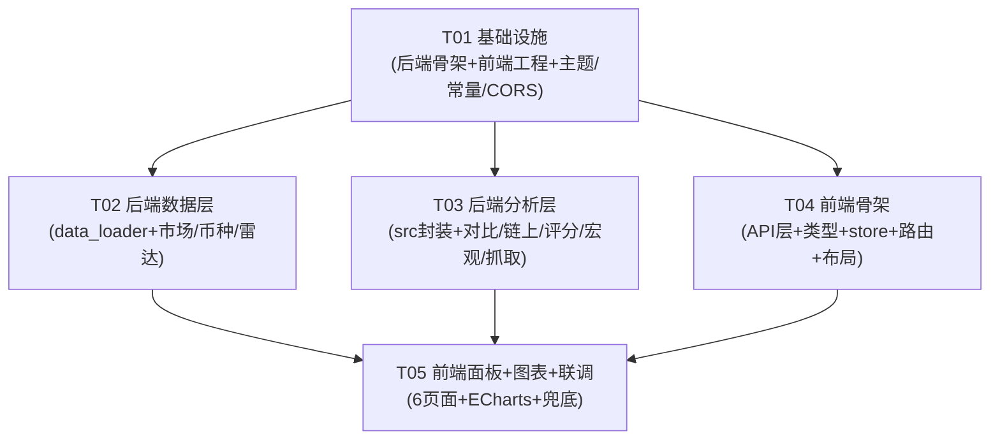

# claude_trading 投研控制台 — 系统架构设计与任务分解

> **文档类型**：架构设计 + 任务分解（Architecture & Task Breakdown）
> **作者**：高见远（架构师）
> **面向**：工程师（实现依据）
> **技术栈**：后端 FastAPI（Python 3.9+）｜前端 Vite + React + MUI + Tailwind + ECharts
> **版本**：v0.1（初稿，对应 PRD v0.1）

---

## 0. 设计摘要（中转用，5–8 行）

- **架构一句话**：全栈投研控制台——FastAPI 后端复用 `src/` 既有分析模块（token_defi / web_research / chain / scorer / advice / btc_dominance / comparison）+ 读取本地 `daily_scan` 与 `raw_server` 数据，React 前端以 ECharts 深色科技风渲染 6 面板。
- **后端路由**：9 个端点（8 个 PRD 草案 + 1 个实时抓取 + 1 个 health），纯本地数据端点零网络依赖，分析类端点 best-effort 容错。
- **前端页面**：6 个面板页面 + 1 个全局布局/导航 + 共享图表/状态层；图表统一用 **ECharts（echarts-for-react）**，MUI 仅做布局/组件/主题。
- **任务总数**：5 个（T01 基础设施 → T02 后端数据层 → T03 后端分析层 → T04 前端骨架 → T05 前端面板与联调），覆盖 P0→P1。
- **关键选型**：ECharts 雷达/柱状（与现有看板风格一致）、Vite dev proxy `/api`→`localhost:8000`、统一响应信封 `{code,message,data}`、红涨绿跌（国内惯例 `#f6465d`/`#2ebd85`）。
- **应用目录**：新建 `console/backend/`（FastAPI）与 `console/frontend/`（Vite React），后端根 `sys.path` 注入项目根以 `import src`。

---

## 1. 实现方案（Implementation Approach）

### 1.1 技术难点与框架选型

| 难点 | 方案 | 选型理由 |
|------|------|----------|
| 本地海量 JSON/Parquet 读取 | 自研 `data_loader` 服务层 | 复用 `build_dashboard.collect_dashboard_data` 思路，集中封装 `daily_scan`/`raw_server` 读取、最新日期解析、缺失兜底；不引入重 ORM |
| 复用 `src/` 复杂分析模块（多依赖网络） | 薄服务封装层（Service） | 直接 `import src.*`，用 try/except + 超时封装；失败返回空结构而非 500，保证首屏可用 |
| 深色科技风 + 玻璃拟态 + 多面板导航 | MUI + Tailwind 共存 | MUI 负责布局/主题/组件，Tailwind 负责工具类与玻璃卡片样式；通过 `tailwind` 仅在 className 用、`Mui` 走 `sx` 避免冲突 |
| 雷达图 / 趋势图 / 分布图 | **ECharts（echarts-for-react）** | 与现有 `build_dashboard` 看板风格一致，雷达图天然契合「百倍币多维度评分」与「链上 8 维」；Recharts 能力不足 |
| 前后端本地联调 | Vite dev proxy | `vite.config.ts` 将 `/api` 代理到 `http://localhost:8000`，前端无需硬编码地址；prod 用 CORS 白名单 |
| 实时抓取（web_research）长耗时、可能失败 | 同步触发 + 前端 loading + 超时兜底 | 面向本地单人；`POST /api/tokens/{id}/research` 直接调用（带超时），超时/失败返回离线基线 + 提示，不阻塞首屏 |

### 1.2 架构模式

- **后端**：分层架构 = `Routers`（HTTP 路由） → `Services`（业务/复用 src） → `DataLoader`（本地 IO）。所有响应走统一信封。
- **前端**：组件化 + 路由（react-router） + 轻量全局状态（React Context/Zustand，仅存 `date`、`selectedTokens`、`theme`）。API 请求层集中在 `api/client.ts`。
- **数据流向**：前端 `api/client` → FastAPI Router → Service →（本地文件 OR `src` 模块）→ Pydantic 响应模型 → JSON 信封 → 前端 TS 类型 → ECharts/MUI 渲染。

### 1.3 本地联调方式

- 后端：`uvicorn console.backend.main:app --reload --host 127.0.0.1 --port 8000`（根 `sys.path` 注入项目根，故可 `import src`）。
- 前端：`npm run dev`（Vite 默认 5173），`vite.config.ts` 中 `server.proxy['/api'] = 'http://localhost:8000'`。
- 联调验证：`GET http://localhost:5173/api/market/overview` 应经代理命中后端；`/docs` 可直接访问后端 OpenAPI。

---

## 2. 文件列表（File List）

### 2.1 后端 `console/backend/`

```
console/backend/
├── requirements.txt                 # Python 依赖（fastapi/uvicorn/pandas/pyarrow/pydantic...）
├── main.py                          # FastAPI app 入口：CORS、路由挂载、异常处理器
├── config.py                        # 全局配置：项目根、数据目录、CORS origins、雷达权重
├── core/
│   ├── __init__.py
│   ├── paths.py                     # 路径常量 + 最新日期解析 resolve_scan_date()
│   └── exceptions.py                # 统一异常 → 信封 {code,message,data}
├── schemas/                         # Pydantic 响应模型（与前端 TS 对应）
│   ├── __init__.py
│   ├── common.py                    # ApiEnvelope, CoinBrief, NewsItem, SectorStat
│   ├── market.py                    # MarketOverviewResponse
│   ├── token.py                     # TokenDetailResponse, WebResearchResponse
│   ├── opportunity.py               # OpportunityRadarResponse, OpportunityItem
│   └── analysis.py                  # ComparisonResponse, OnchainResponse, ScoreResponse, MacroResponse
├── services/
│   ├── __init__.py
│   ├── data_loader.py               # 读取 daily_scan/raw_server；latest date；缺失兜底
│   ├── market_service.py            # 市场总览聚合（KPI/分布/涨跌/板块）
│   ├── token_service.py             # 币种档案（离线基线：deep/by_category）
│   ├── opportunity_service.py       # 百倍币雷达打分（启发式）
│   ├── defi_service.py              # 封装 src.research.token_defi
│   ├── chain_service.py             # 封装 src.chain.orchestrator.analyze
│   ├── score_service.py             # 封装 src.analysis.scorer + advice
│   ├── macro_service.py             # 封装 src.analysis.btc_dominance
│   ├── comparison_service.py        # 封装 src.analysis.comparison
│   └── web_research_service.py      # 封装 src.research.web_research（实时抓取）
└── routers/
    ├── __init__.py
    ├── market.py                    # /api/market/overview, /api/tokens, /api/tokens/{id}
    ├── opportunity.py               # /api/opportunity/radar
    ├── comparison.py                # /api/comparison
    ├── onchain.py                   # /api/onchain
    ├── score.py                     # /api/score/{id}
    ├── macro.py                     # /api/macro/btc-dominance
    └── research.py                  # /api/tokens/{id}/research（实时抓取）
```

### 2.2 前端 `console/frontend/`

```
console/frontend/
├── package.json                    # 依赖与脚本（dev/build/preview）
├── vite.config.ts                  # Vite + /api 代理到 :8000
├── tailwind.config.js              # Tailwind 配置（玻璃卡片/渐变工具类）
├── postcss.config.js
├── tsconfig.json / tsconfig.node.json
├── index.html                      # 入口 HTML（挂载 #root）
└── src/
    ├── main.tsx                    # React 入口（ThemeProvider + Router + QueryClient）
    ├── App.tsx                     # 顶层：布局 + 路由出口
    ├── theme.ts                    # MUI 深色主题 + ECharts 暗色 token
    ├── index.css                   # Tailwind 指令 + 全局底色/滚动条
    ├── api/
    │   ├── client.ts               # axios 实例 + 拦截器（信封解包/错误兜底）
    │   └── endpoints.ts            # 端点常量
    ├── types/
    │   └── models.ts               # TS 类型（与后端 Pydantic 对应）
    ├── store/
    │   └── useAppStore.ts          # 全局状态：date / selectedTokens / themeMode
    ├── router.tsx                  # react-router 路由表（6 面板）
    ├── layout/
    │   ├── AppLayout.tsx           # 顶部导航 + 内容区骨架
    │   └── NavBar.tsx              # Logo + 6 Tab + 全局日期选择（P2 预留）
    ├── components/
    │   ├── common/                 # Card(玻璃), EmptyState, Loading, ErrorBoundary, PageHeader
    │   └── charts/                 # EChart.tsx(封装 echarts-for-react) + RadarChart/BarChart/KpiCard/HeatMap
    └── pages/
        ├── MarketOverview.tsx      # ① 市场总览（P0）
        ├── TokenProfile.tsx        # ② 币种档案（P0，含实时抓取按钮）
        ├── Comparison.tsx          # ③ 竞品对比（P1）
        ├── Onchain.tsx             # ④ 链上分析（P1）
        ├── ScoreAdvice.tsx         # ⑤ 评分与建议（P1）
        └── OpportunityRadar.tsx    # ⑥ 百倍币机会雷达（P0）
```

---

## 3. 数据结构与接口（Data Structures & Interfaces）

> 完整类图见 `class-diagram.mermaid`。以下给出关键响应模型与端点清单。

### 3.1 统一响应信封（所有 API 一致）

```jsonc
{ "code": 0, "message": "ok", "data": { ... } }
// code: 0=成功; 404=日期/数据不存在(返回 data=空结构); 5xx=内部错误(经异常处理转 4xx 信封)
```

### 3.2 API 端点清单

| # | 方法 | 路径 | 入参 | 返回 `data` | 数据来源 |
|---|------|------|------|-------------|----------|
| E1 | GET | `/api/health` | — | `{status, version, dataDate}` | 本地 |
| E2 | GET | `/api/market/overview` | `?date=` | `MarketOverviewResponse` | `summary.json`+`top_800_light`+`by_category` |
| E3 | GET | `/api/tokens` | `?date=&q=&limit=` | `CoinBrief[]` | `top_800_light/all_coins.json` |
| E4 | GET | `/api/tokens/{id}` | `?date=` | `TokenDetailResponse` | `top_50_detailed/*`、`by_category/*` |
| E5 | GET | `/api/opportunity/radar` | `?date=&mcapMax=&sort=` | `OpportunityRadarResponse` | `top_800_light`+`top_50_detailed`+`by_category` |
| E6 | POST | `/api/comparison` | body `{coin_ids:[...]}` | `ComparisonResponse` | `src.analysis.comparison`（网络） |
| E7 | GET | `/api/onchain` | `?chain=&query=&date=` | `OnchainResponse` | `src.chain.orchestrator.analyze`（网络/demo） |
| E8 | GET | `/api/score/{id}` | `?date=` | `ScoreResponse` | `src.analysis.scorer`+`advice`（网络） |
| E9 | GET | `/api/macro/btc-dominance` | — | `MacroResponse` | `src.analysis.btc_dominance`（网络） |
| E10 | POST | `/api/tokens/{id}/research` | body `{force?}` | `WebResearchResponse` | `src.research.web_research`（网络，失败兜底） |

> 说明：E2–E5 纯本地零网络；E6–E10 调用 `src` 模块可能触网，service 层**全部 try/except 包裹**，失败返回 `data`=空结构 + `message` 说明（不抛 500）。

### 3.3 关键 Pydantic 响应模型（节选）

```python
# schemas/common.py
class CoinBrief(BaseModel):
    id: str; sym: str|None; name: str|None; rank: int|None
    price: float|None; mcap: float|None; vol: float|None
    chg24: float = 0; chg7d: float = 0

class NewsItem(BaseModel):
    title: str|None; url: str|None; source: str|None; date: str|None; kind: str|None

class SectorStat(BaseModel):
    cat: str; count: int; mcap: float|None; avgChg: float = 0

# schemas/market.py
class MarketOverviewResponse(BaseModel):
    meta: dict            # {date, prevDay, scanTime, deepTotal, lightTotal}
    kpi: dict             # {totalMcap, coinCnt, avgChg, upCnt, downCnt, fearGreed, btcDominance?}
    distribution: dict    # {labels:[...], values:[...]}  涨跌分布直方图
    gainers: list[CoinBrief]; losers: list[CoinBrief]
    topByMcap: list[CoinBrief]
    sectors: list[SectorStat]

# schemas/opportunity.py
class OpportunityItem(BaseModel):
    id: str; sym: str|None; name: str|None; rank: int|None; mcap: float|None
    composite: float                       # 综合机会分 0-100
    dims: dict                             # {mcapScale, growth, narrative, community, onchain} 各 0-100
    category: str|None
class OpportunityRadarResponse(BaseModel):
    meta: dict        # {date, count, weights}
    rankings: list[OpportunityItem]

# schemas/token.py
class TokenDetailResponse(BaseModel):
    basic: CoinBrief
    ath: float|None; athChg: float|None
    narrative: dict      # {description, categories, genesisDate, officialLinks, communityLinks}
    social: dict         # {mentions, upvotes, redditSubs, communityScore, newsCount, sentiment, signal}
    news: list[NewsItem] # 离线基线（计数驱动）；实时抓取后填充列表
    scoresAvailable: bool; onchainAvailable: bool
    dataSource: str = "offline"   # offline | live

class WebResearchResponse(BaseModel):
    coinId: str; symbol: str|None; name: str|None
    description: str|None; categories: list[str] = []
    officialLinks: dict = {}; communityLinks: dict = {}
    sentiment: dict = {}; watchlistUsers: int|None
    news: list[NewsItem] = []
    sources: list[str] = []; confidence: float = 0.0; fetchedAt: str|None

# schemas/analysis.py
class ComparisonResponse(BaseModel):
    projects: list[dict]; matrix: dict; winner: str; summary: str

class OnchainResponse(BaseModel):
    chain: str; address: str; symbol: str|None; name: str|None
    dims: dict     # {security,trend,momentum,liquidity_health,sentiment,innovation,taxonomy,community} 各 0-10
    total: float; decision: str; risk: str; position: str
    triggers: list[str] = []; missing: list[str] = []; flags: list[dict] = []
    disclaimer: str

class ScoreResponse(BaseModel):
    coinId: str; name: str|None; symbol: str|None
    scores: dict   # {market,technical,onchain,sentiment,github,social,risk} 各 0-5
    totalScore: float; rating: str; recommendation: str; riskLevel: str
    advice: dict   # {action, positionRange, horizon, triggers, rationale, disclaimer}

class MacroResponse(BaseModel):
    currentDominance: float; trend: str; marketPhase: str
    altcoinSeason: bool; recommendation: str
```

### 3.4 前端 TypeScript 类型（`types/models.ts`，与后端一一对应）

```ts
export interface ApiEnvelope<T> { code: number; message: string; data: T }
export interface CoinBrief { id:string; sym?:string; name?:string; rank?:number;
  price?:number; mcap?:number; vol?:number; chg24?:number; chg7d?:number }
export interface NewsItem { title?:string; url?:string; source?:string; date?:string; kind?:string }
export interface SectorStat { cat:string; count:number; mcap?:number; avgChg:number }
export interface MarketOverview { meta:Record<string,any>; kpi:Record<string,any>;
  distribution:{labels:string[];values:number[]}; gainers:CoinBrief[]; losers:CoinBrief[];
  topByMcap:CoinBrief[]; sectors:SectorStat[] }
export interface OpportunityItem { id:string; sym?:string; name?:string; rank?:number;
  mcap?:number; composite:number; dims:Record<string,number>; category?:string }
export interface OpportunityRadar { meta:Record<string,any>; rankings:OpportunityItem[] }
export interface TokenDetail { basic:CoinBrief; ath?:number; athChg?:number;
  narrative:Record<string,any>; social:Record<string,any>; news:NewsItem[];
  scoresAvailable:boolean; onchainAvailable:boolean; dataSource:string }
export interface WebResearch { coinId:string; symbol?:string; name?:string; description?:string;
  categories:string[]; officialLinks:Record<string,any>; communityLinks:Record<string,any>;
  sentiment:Record<string,any>; watchlistUsers?:number; news:NewsItem[];
  sources:string[]; confidence:number; fetchedAt?:string }
export interface Comparison { projects:any[]; matrix:Record<string,any>; winner:string; summary:string }
export interface Onchain { chain:string; address:string; symbol?:string; name?:string;
  dims:Record<string,number>; total:number; decision:string; risk:string; position:string;
  triggers:string[]; missing:string[]; flags:any[]; disclaimer:string }
export interface Score { coinId:string; name?:string; symbol?:string; scores:Record<string,number>;
  totalScore:number; rating:string; recommendation:string; riskLevel:string; advice:Record<string,any> }
export interface Macro { currentDominance:number; trend:string; marketPhase:string;
  altcoinSeason:boolean; recommendation:string }
```

### 3.5 百倍币雷达打分启发式（opportunity_service，初值权重，可调）

维度（均归一化到 0–100，雷达图取此值）：

| 维度 | 权重 | 计算（数据来源） |
|------|------|------------------|
| `mcapScale` 市值规模 | 0.25 | 小市值加分：`100 * (1 - log10(mcap)/log10(maxMcap))`，市值越小分越高（仅纳入 mcap < 阈值，如 < $5B） |
| `growth` 成长性 | 0.25 | `w1*norm(chg7d) + w2*norm(成交量/市值比)`，取 top_800_light 的 chg7d、vol/mcap |
| `narrative` 叙事热度 | 0.20 | `hasCategory?40:0 + norm(newsCount)*30 + norm(mentions)*30`（来自 deep/by_category） |
| `community` 社区强度 | 0.15 | `norm(redditSubs)*60 + norm(communityScore)*40`（来自 deep） |
| `onchain` 链上健康 | 0.15 | best-effort 代理：`norm(vol/mcap)*50 + norm(ageDays 适中)*30 + liquidityProxy*20`；无链上数据时该维留空（雷达不画该轴，composite 按其余维度加权） |

- **composite** = Σ(weightᵢ × dimᵢ)，仅对非空维度加权并归一。
- **筛选/排序**：`?mcapMax=` 限制市值上限；`?sort=` 支持 composite / growth / community。
- **假设**：权重初值为启发式起点，后续由产品/工程调参（见待明确事项 Q1）。

---

## 4. 程序调用流程（Program Call Flow）

> 完整时序图见 `sequence-diagram.mermaid`。两场景如下。

**场景 A：打开百倍币机会雷达（纯本地）**
```
前端 OpportunityRadar 挂载
  → api/client GET /api/opportunity/radar?date=latest
  → FastAPI router.opportunity → opportunity_service.compute()
      → data_loader.resolve_scan_date() 解析最新日期
      → data_loader.load_all_coins() / load_deep() / load_by_category()
      → 启发式打分（5 维归一 + 加权）
  → 返回 ApiEnvelope[OpportunityRadar]
  → 前端渲染排行榜表格 + ECharts 雷达图（选中行联动）
```

**场景 B：查看币种档案并触发实时抓取**
```
前端 TokenProfile 挂载（路由 /token/:id）
  → GET /api/tokens/{id}?date=latest
  → token_service.build_detail() 读 top_50_detailed + by_category（离线基线）
  → 返回 TokenDetail(dataSource="offline")，首屏渲染叙事/社区/新闻计数
用户点击「实时抓取」
  → POST /api/tokens/{id}/research  → web_research_service.analyze()
      → src.research.web_research.TokenWebResearcher.analyze(id)  [可能触网/超时]
      → 成功：返回 WebResearch(news 列表/叙事/链接)
      → 失败：返回空结构 + message，前端保留离线内容并提示
  → 前端合并 news/narrative，ECharts/列表刷新；loading 与兜底态完整
```

---

## 5. 待明确事项（Anything UNCLEAR / 假设）

1. **百倍币权重初值**（§3.5）为启发式起点，是否需产品/工程联调后修订？是否允许用户前端调权重（P2）？
2. **鉴权**：默认**纯本地单人、无登录**（PRD Open Q2）。故后端不做会话/多租户；如未来需鉴权，在 `main.py` 增加中间件即可。
3. **部署**：默认本地 `uvicorn`+`npm run dev`；暂不做 Docker/HTTPS（Open Q3）。prod 用 `vite build` + 后端同源或 CORS 白名单。
4. **CORS**：开发期 Vite proxy 已覆盖；为 prod 预置 `config.CORS_ORIGINS` 白名单（默认 `http://localhost:5173` + 同源），`main.py` 启用 `CORSMiddleware`。
5. **实时抓取限流/缓存**（PRD P2-01）：当前仅在币种档案单点触发；全局限流与本地缓存（`data/cache`）交由 P2。单次调用带超时（默认 25s），失败不阻塞。
6. **链上分析入参**：`/api/onchain?chain=&query=` 需「链+符号/地址」；币种档案页跳转时如仅有 CoinGecko id 而无链上地址，需用户补地址或后端 best-effort 解析（可能失败 → 空结构）。
7. **日期切换**（P2-02）：`?date=` 已贯穿后端；前端全局日期选择器留 P2，当前默认 latest。
8. **BTC 占比**在 `summary.json` 未直接给出，市场总览的 `btcDominance` 由 macro 服务 best-effort 填充（可能 null），不阻塞总览。

---

## 6. 依赖包列表（Required Packages）

### 后端 `console/backend/requirements.txt`（Python 3.9+）
```
fastapi>=0.110,<1.0
uvicorn[standard]>=0.27
pandas>=2.0
pyarrow>=14.0          # 读 parquet
pydantic>=2.5
python-multipart>=0.0.9
# 以下为复用 src 模块所需（项目根已装则沿用）
requests>=2.31
beautifulsoup4>=4.12   # web_research 静态抓取
lxml>=5.0
```
> 注：`src/` 自身依赖（coingecko/defillama/reddit 客户端、scrapling/playwright 可选）沿用项目根 `requirements.txt`，控制台不重复声明；后端通过 `sys.path` 注入项目根复用。

### 前端 `console/frontend/package.json`（Node 18+）
```
react@^18.3.1
react-dom@^18.3.1
react-router-dom@^6.26.0
@mui/material@^5.16.0
@mui/icons-material@^5.16.0
@emotion/react@^11.13.0
@emotion/styled@^11.13.0
echarts@^5.5.0
echarts-for-react@^3.0.2
axios@^1.7.0
tailwindcss@^3.4.0
postcss@^8.4.0
autoprefixer@^10.4.0
vite@^5.4.0
@vitejs/plugin-react@^4.3.0
typescript@^5.5.0
```

---

## 7. 任务列表（Task List，按实现顺序，依赖前置）

> 约束：共 5 个任务（≤5），首个为基础设施，每个 ≥3 文件，按层/模块分组。

### T01 · 项目基础设施（P0，无前置）
- **目标**：搭建后端 FastAPI 骨架与前端 Vite 工程，定义共享常量/主题/路径/CORS，依赖声明。
- **涉及文件**：
  - 后端：`console/backend/requirements.txt`、`console/backend/main.py`、`console/backend/config.py`、`console/backend/core/paths.py`、`console/backend/core/exceptions.py`
  - 前端：`console/frontend/package.json`、`console/frontend/vite.config.ts`、`console/frontend/tailwind.config.js`、`console/frontend/tsconfig.json`、`console/frontend/index.html`、`console/frontend/src/main.tsx`、`console/frontend/src/App.tsx`、`console/frontend/src/theme.ts`、`console/frontend/src/index.css`
- **依赖**：无　**优先级**：P0

### T02 · 后端数据层 + 本地读取 + 市场/币种/雷达路由（P0）
- **目标**：实现 `data_loader`（含 latest 日期解析与缺失兜底）、市场总览/币种列表/币种档案/百倍币雷达的服务与路由，纯本地零网络。
- **涉及文件**：
  - `console/backend/core/__init__.py`、`console/backend/schemas/common.py`、`console/backend/schemas/market.py`、`console/backend/schemas/token.py`、`console/backend/schemas/opportunity.py`
  - `console/backend/services/data_loader.py`、`console/backend/services/market_service.py`、`console/backend/services/token_service.py`、`console/backend/services/opportunity_service.py`
  - `console/backend/routers/market.py`、`console/backend/routers/opportunity.py`
- **依赖**：T01　**优先级**：P0

### T03 · 后端分析层 + 分析类路由（P1，复用 src）
- **目标**：薄封装 `src` 模块（token_defi/chain/scorer/advice/btc_dominance/comparison/web_research），提供竞品对比/链上/评分/宏观/实时抓取路由；全部 best-effort 容错。
- **涉及文件**：
  - `console/backend/schemas/analysis.py`
  - `console/backend/services/defi_service.py`、`console/backend/services/chain_service.py`、`console/backend/services/score_service.py`、`console/backend/services/macro_service.py`、`console/backend/services/comparison_service.py`、`console/backend/services/web_research_service.py`
  - `console/backend/routers/comparison.py`、`console/backend/routers/onchain.py`、`console/backend/routers/score.py`、`console/backend/routers/macro.py`、`console/backend/routers/research.py`
- **依赖**：T01、T02（复用 schemas/paths）　**优先级**：P1

### T04 · 前端骨架 + 状态/路由 + API 层 + TS 类型 + 主题（P0）
- **目标**：前端工程化骨架：API client（信封解包/兜底）、TS 类型、全局 store、路由表、布局/导航/玻璃主题，确保 6 面板路由可切换无白屏。
- **涉及文件**：
  - `console/frontend/src/api/client.ts`、`console/frontend/src/api/endpoints.ts`、`console/frontend/src/types/models.ts`
  - `console/frontend/src/store/useAppStore.ts`、`console/frontend/src/router.tsx`
  - `console/frontend/src/layout/AppLayout.tsx`、`console/frontend/src/layout/NavBar.tsx`
  - `console/frontend/src/components/common/`（Card/EmptyState/Loading/ErrorBoundary/PageHeader）
- **依赖**：T01　**优先级**：P0

### T05 · 前端 6 面板组件 + ECharts 图表 + 联调收尾（P0→P1）
- **目标**：实现 6 个面板页面与 ECharts 图表封装（雷达/柱状/分布/热力），接入实时抓取交互，完成前后端联调、错误/空态兜底、dev/prod 启动脚本与最小自测。
- **涉及文件**：
  - `console/frontend/src/components/charts/`（EChart.tsx、RadarChart.tsx、BarChart.tsx、KpiCard.tsx、HeatMap.tsx）
  - `console/frontend/src/pages/MarketOverview.tsx`、`TokenProfile.tsx`、`Comparison.tsx`、`Onchain.tsx`、`ScoreAdvice.tsx`、`OpportunityRadar.tsx`
  - 启动/联调脚本：`console/backend/run.sh`（uvicorn）、`console/frontend/README` 中的 `npm run dev`；可选 `console/README.md` 集成说明
- **依赖**：T04、T02、T03　**优先级**：P0（总览/档案/雷达）+ P1（对比/链上/评分）

---

## 8. 共享知识（Shared Knowledge / 跨文件约定）

- **响应信封**：所有 API 返回统一 `{code,message,data}`；`code=0` 成功，非 0 见 §3.1。`api/client.ts` 拦截器统一解包 `data` 并兜底。
- **日期参数**：所有读数据端点支持 `?date=YYYY-MM-DD`；缺省或 `date=latest` → `data_loader.resolve_scan_date()` 取 `data/reports/daily_scan/` 下字典序最大且含 `summary.json` 的目录。
- **路径常量**：集中在 `console/backend/core/paths.py`：`PROJECT_ROOT`（注入 `sys.path`）、`DAILY_SCAN_DIR`、`RAW_SERVER_DIR`；前端无路径概念，仅经 API。
- **ECharts 暗色 token**（`theme.ts` 与后端无直接关系，前端统一）：
  - 背景 `#0d1117` / 面板 `#161b22` / 边框 `#30363d` / 主文 `#e6edf3` / 次文 `#8b949e`
  - 主色渐变：蓝 `#3b82f6`、青 `#22d3ee`、紫 `#8b5cf6`；强调 `#58a6ff`
  - **红涨绿跌（国内惯例）**：涨 `#f6465d`、跌 `#2ebd85`（与 `build_dashboard` `--up/--down` 一致）
- **错误兜底约定**：本地文件缺失/解析失败 → 返回 `data`=该结构空默认值 + `message` 说明，**绝不 500**；`src` 模块网络失败 → service 捕获返回空结构 + 标记 `dataSource`，前端保留离线内容。
- **免责声明**：评分/建议/链上/宏观涉及投资参考处，前端展示 `advice.disclaimer` / `onchain.disclaimer`（来自 `src` 模块常量），强制呈现。
- **CORS**：`main.py` 启用 `CORSMiddleware`，`allow_origins=config.CORS_ORIGINS`（默认含 `http://localhost:5173`）；dev 以 Vite proxy 为主。
- **日志**：service 层网络失败用 `print/logging.warning` 记录（沿用 src 风格），不向上抛。

---

## 9. 任务依赖图（Task Dependency Graph）


