# claude_trading 历史数据库层 —— 系统架构设计与任务分解

| 项 | 内容 |
|---|---|
| 文档 | `docs/history-db/ARCHITECTURE.md` |
| 版本 / 日期 | v1.0 / 2026-09-28 |
| 作者 | 高见远（架构师） |
| 上游依据 | `docs/history-db/PRD.md`（许清楚）+ 团队主理人实测补充 + **本文档 §0 的三项实测验证** |
| 技术栈（经实测校正） | 后端 FastAPI + DuckDB 1.5.5 单文件；前端 React 18 + Vite + MUI v5 + ECharts（**Tailwind 已于上一轮重构整条删除，PRD 第 10 行过时，本文以实测为准**） |
| 交付清单 | 本文档 + `docs/history-db/sequence-diagram.mermaid` + `docs/history-db/class-diagram.mermaid` |

---

## 0. 关键实测验证（先于设计，避免臆测）

> 以下三项为硬性要求「验证而非臆测」的产出，全部在本机实跑（Python 环境 `C:/Users/P52S/.workbuddy-ai/binaries/python/envs/default/Scripts/python.exe`，duckdb 1.5.5）。

### 验证 1：DuckDB FTS 扩展可用性 + 中文/英文检索方案（决定 R5/US-5 能否落地）

> **本节于 v1.1 修订**：初版结论「对正文单独建 FTS 即可 + 把 grams 列单独建索引」经团队主理人复验存在**会导致英文检索全面失效的缺陷**。
> 以下是修订后的**独立复现实测**（同一环境 duckdb 1.5.5）。样表 `t(id, body, body_grams)`：

```python
# 样例数据
# id=1 body='以太坊 ETF 审批通过 利好'  grams='以太 太坊 审批 批通 通过 利好 ETF'   （CJK bigram + 英文整词）
# id=2 body='Solana 生态 TVL 创新高'    grams='生态 态T TV VL L创 创新 新高 Solana'
# id=3 body='Uniswap 治理论坛提案'      grams='治理 理论 论坛 坛提 提案 Uniswap'
con.execute("PRAGMA create_fts_index('t','id','body');")                    # 模式A：仅 body
con.execute("PRAGMA create_fts_index('t','id','body_grams');")              # 模式B：仅 grams
con.execute("PRAGMA create_fts_index('t','id','body','body_grams');")       # 模式C：body + grams 双列单索引
# 查询（标量函数写法）：
"SELECT id FROM (SELECT *, fts_main_t.match_bm25(id, ?) s FROM t) x WHERE s IS NOT NULL;"
```

**实测对照（结果 = 命中的 id 列表）**

| 关键词 | 模式A 仅 `body` | 模式B 仅 `body_grams` | **模式C `body`+`body_grams`（采用）** |
|---|---|---|---|
| `Solana`（英文整词） | ✅ [2] | ✅ [2]\* | ✅ [2] |
| `Uniswap` | ✅ [3] | ✅ [3]\* | ✅ [3] |
| `ETF` / `TVL` | ✅ | ✅ | ✅ |
| `以太坊`（中文全词） | ✅ [1] | ❌ []  | ✅ [1] |
| `以太`（中文子串） | ❌ [] | ✅ [1] | ✅ [1] |
| `治理`（中文子串） | ❌ [] | ✅ [3] | ✅ [3] |
| `坊`（单字） | ❌ [] | ❌ [] | ❌ []（bigram 最小粒度=2 字，可接受） |

\* 模式B 的英文命中**取决于 grams 生成方式**：若把英文也切碎成大/小 bigram（如 `Solana→Sola olan lana`），则 `'Solana'` **❌ 搜不到**——crypto 领域币名/协议名多为英文，这会使 US-5 大面积失效；本表模式B 之所以命中，是因为 grams 保留了英文整词。**结论：不采用「仅索引 grams 列」，改用模式C 双列单索引，彻底规避该风险。**

**结论（修订版）**
- `INSTALL/LOAD fts` 与 `PRAGMA create_fts_index` **均成功**；扩展本地缓存于
  `C:\Users\P52S\.duckdb\extensions\v1.5.5\windows_amd64\fts.duckdb_extension`（`REPOSITORY/core`），**无需联网**。→ **FTS = AVAILABLE**。
- **避坑1（查询写法）**：`match_bm25` 是 schema 内**标量函数** `fts_main_<table>.match_bm25(pk_col, query)`，
  **不能**写成 `FROM fts_main_docs.match_bm25(...)`（报 `Table Function ... does not exist`）。
- **避坑2（中文机制，精确表述）**：DuckDB simple 分词器**不切分 CJK**，把**连续中文当作单个 token**。因此：
  **整块连续中文可命中**（如 `'以太坊'` 对 `body='以太坊 ETF…'` 命中），但**任意子串不可命中**（`'以太'`/`'坊'` 对整块 `'以太坊'` 不命中）。
  （初版称「`'以太坊'` 返回空」是该样本恰好为**一整段无空格 CJK** 的特例，表述不精确，此处更正。）
  ⚠️ **此「中文可命中」仅对上方 3 行合成样表成立，不可外推到真实语料**——真实库 `body_text` 中文占比仅 ~5%，
  且查询侧还需 bigram 化；实测 **`'以太坊'` 在真实库召回 0**（见下「真实语料复验」）。
- **解法（模式C）**：`content_archive` 同时保留 `body_text`（原文）与 `body_grams`（CJK 字符 bigram + **英文整词**）两列，
  用**一条索引覆盖两列**：`create_fts_index('content_archive','content_id','body_text','body_grams', overwrite=1)`。
  → 英文整词由 `body_text` 命中，中文 bigram 由 `body_grams` 命中，**中英两种粒度都被索引覆盖**；实测 bm25 分数正常可用于排序。
  （注：**粒度覆盖 ≠ 词覆盖**——中文能否召回取决于该词的 bigram 是否在语料 `dict` 中，见 §8.1「中文召回可达性判据」。）
- **查询侧必须对 CJK 做 bigram 化（v1.3 订正）**：`match_bm25` 用**同一 simple 分词器**解析查询串，
  故**未 bigram 化的连续 CJK 词（如 `'哔哩哔哩'`、`'以太坊'`）作为单个 token 不在索引里 → 召回 0**。
  **必须**先把查询串里的 CJK 段展开成 bigram（见 §8 H5 规格），再把结果传给 `match_bm25`。
  → 初版「查询侧无需 bigram 化」的结论**错误**（仅基于 3 行合成样表得出），详见下方「真实语料复验」。
- **⚠️ FTS 索引是静态的（顺序敏感）**：`create_fts_index` 只索引**建索引那一刻已存在的行**；之后的 INSERT **不会**自动入索引，
  必须 `overwrite=1` **重建**才可见（实测：先建索引后插入 → 查不到；重建后 → 命中）。
  → ETL 顺序固定为：**先写全部数据，最后建/重建 FTS**（§5.1 步骤⑦、§6 增量末步）。
- **兜底**：FTS 扩展不可用时降级 `body_text ILIKE '%kw%'`（全表列扫），保证 US-5 不彻底失效。

#### 真实语料复验（v1.3，**推翻了上方合成样表的乐观结论**）

上方模式A/B/C 对照表基于 **3 行合成数据**（`body='以太坊 ETF 审批通过 利好'`）得出。团队主理人在真实库
`data/history/ct_history.duckdb`（`content_archive` **39,352 行**）复验后，发现关键结论**在真实语料上不成立**。
以下为**我的独立复验**（`read_only` 连接，未改库）：

| 实测项（真实库） | 值 |
|---|---|
| `match_bm25(content_id,'Solana')` / `'Ethereum'` / `'ETF'` / `'Uniswap'` | 869 / 2,339 / 667 / 22（**英文正常**） |
| `match_bm25(content_id,'哔哩哔哩')` / `'以太坊'` / `'比特币'`（**原始 CJK，未 bigram 化**） | **0 / 0 / 0** |
| `match_bm25(content_id,'哔哩 哩哔')`（bigram 化后） | **455** |
| `match_bm25(content_id,'以太 太坊')`（bigram 化后） | **0**（语料中无此 bigram，见下） |
| `fts_main_content_archive.dict` 实查 | `'哔哩'`(1603, df 455)、`'哩哔'`(1604, 455) **存在**；`'哔哩哔哩'`/`'以太'`/`'太坊'`/`'比特'`/`'特币'`/`'治理'` **均不存在** |
| `body_text LIKE '%哔哩%'` | **0** |
| `body_text` 含 CJK 的行 | **2,117 / 39,352 ≈ 5.4%**（`title` 含 CJK 为 2,730 行） |

**根因**：中文内容**主要在 `title`**（如 bilibili 标题 `'aster-2-哔哩哔哩_bilibili'`），而索引是对 `body_grams = grams(title + 正文)` 建的；
`body_text`（纯正文）含中文的行仅约 5%。故「**中文全词由 `body_text` 命中**」这条路径在真实语料上**几乎不存在**；
`body_text` 分列只对英文有效。而 `body_grams` 里的中文是 **bigram**，所以：
- **查询侧若不做 bigram 化** → 连续 CJK 词作单个 token → 索引无此 token → **召回 0**（实测 `'哔哩哔哩'=0`）；
- **查询侧 bigram 化后** → `'哔哩 哩哔'` → 命中 455（实测；**但仅对语料中存在的词成立**——`'以太坊'` 的 bigram 亦不在 `dict`，仍为 0，见 §8.1 可达性判据）。

**订正结论**：
1. 「中文全词可命中」**仅在**该词作为**独立 token 出现在 `body_text`** 时成立——真实数据中极罕见（`body_text` 中文占比 ~5%）。
2. **H5 端点查询侧必须对 CJK 做 bigram 化**（规格见 §8）。英文词照原样传（已 lowercase 建索引）。
3. **已知召回上限（如实声明）**：受语料限制，`'以太坊'`/`'比特币'` 等词**bigram 化后仍为 0**——因为
   语料正文/标题里根本没有这些字符串（英文标题 + bilibili 站名），**不是**检索 bug。故对 `'以太坊'` 这类关键词，
   FTS 无召回时**必须**回退 `ILIKE` 兜底（见 §8），以覆盖「用户期望搜到但语料确无」的情形。
4. 官方查询范式本身正确（§0 避坑1 保留）：`WHERE fts_main_content_archive.match_bm25(content_id, ?) IS NOT NULL`。

### 验证 2：UPSERT / 幂等能力（决定 R2 落地方式）

```python
c.execute("CREATE TABLE t(d VARCHAR, cid VARCHAR, v DOUBLE, PRIMARY KEY(d,cid));")
c.execute("INSERT INTO t VALUES ('x','btc',1.0);")
c.execute("INSERT INTO t VALUES ('x','btc',9.9) ON CONFLICT (d,cid) DO UPDATE SET v=EXCLUDED.v;")  # -> OK, v=9.9
```

**结论**：`INSERT ... ON CONFLICT (自然键) DO UPDATE SET col=EXCLUDED.col`（需 PK/UNIQUE 约束）**可用**；
`INSERT OR REPLACE` 与 `MERGE INTO` 亦可用。
→ **幂等首选 `ON CONFLICT DO UPDATE`**（原值—新值合并、不丢其它列）；对「整单元会缩水」的子表（正文/源状态）
另用「事务内先 DELETE 该自然键单元再 INSERT」（见 §5）。**这修正了 `src/research/database.py:52-71` 裸 INSERT 不幂等的反面教材。**

### 验证 3：`by_category` 与 `top_50_detailed` 是否 100% 等价（决定 R12 / Q4）

逐日比对（9 个扫描日）：

| 日期 | deep 数 | cat 数 | 交集 | 逐字节相同 | 有差异 | deep-only | cat-only |
|---|---|---|---|---|---|---|---|
| 2026-06-27 | 50 | 50 | 50 | **2** | 48 | 0 | 0 |
| 2026-06-28 | 50 | 50 | 50 | **9** | 41 | 0 | 0 |
| 2026-06-29 | 50 | 50 | 50 | 48 | 2 | 0 | 0 |
| 2026-06-30 | 66 | 66 | 66 | 63 | 3 | 0 | 0 |
| 2026-07-01 | 61 | 61 | 61 | 60 | 1 | 0 | 0 |
| 2026-07-02 | 60 | 60 | 60 | 58 | 2 | 0 | 0 |
| 2026-07-03 | 59 | 59 | 59 | 55 | 4 | 0 | 0 |
| 2026-08-25 | 55 | 55 | 55 | 53 | 2 | 0 | 0 |
| 2026-08-26 | 4 | 4 | 4 | 4 | 0 | 0 | 0 |
| **合计** | **455** | **455** | **455** | **352 (77.4%)** | **103** | **0** | **0** |

典型差异（08-25 `ripple`）：`research_time` 不同（deep `21:09:17` vs cat `16:12:07`）、
`category_slug` 不同（deep `unclassified`（0 个分类） vs cat `layer-1`（11 个分类））、
`market.data.current_price` 不同（`1.44` vs `1.48`）。
`bitcoin` 同理，且 deep 的 `crypto_news` 命中 `429 Too Many Requests` 导致条目数 16 vs 20。

**结论（Q4/R12 裁决依据）**
- **币种集合 100% 相同**（9 日均为 deep-only=0、cat-only=0）→ 以 `(date, coin_id)` 为键「只入一份」**成立**，不会丢币、不会体积翻倍。
- **载荷并不 100% 等价**（仅 77.4% 逐字节相同；06-27/28 差异极大）→ **不能假设同内容**，必须**指定唯一 canonical 源**，否则回填结果不可复现。
- **canonical 选择 = `top_50_detailed`**：与现有 `loader.find_coin_raw` / `loader.load_deep_raw` 的**读取优先级一致**（先读 `top_50_detailed`），从而保证 R8「老端点响应结构不变」；`by_category` 仅用于抽取**权威 `category_slug`**（目录名即分类）作为轻量维度，不重复存载荷。

### 验证 4（附带）：源漂移与其它实测事实

- 逐日 `top_50_detailed` 源集合：**06-27~08-25 全部 14 源**（含 `github`）；**08-26 仅 13 源（缺 `github`）**。
  → 与团队主理人「纠正 1」一致，**PRD 附录 A.2 表格方向写反**，本文以实测为准；建模结论不变（源状态表必须稀疏长表）。
- `raw_server/*.parquet`：实测 5 源各文件 **均 1 行**（github 84 列）→ **确认 R11「暂不入库」合理**（保留现状即可，理由见 §4）。
- 宏观快照 `sources_used` 45 个文件**恒为** `['coingecko/global','coingecko/markets','defillama/tvl']`；顶层 `fear_greed` **恒为 `null`**。
- 宏观：19 个日期、**45 个快照**（日均 2.4，单日最多 6）；`watchlist[14]`、`anomalies[10]`、`chain_tvl{6}`。
- 轻量快照单条 13 字段稳定（已核对）：`id,symbol,name,rank,price_usd,market_cap,volume_24h,change_24h_pct,change_7d_pct,circulating_supply,total_supply,max_supply,timestamp`。

### 验证 5：`load_by_category_raw` 的真实行为（决定 R8 双读一致性，v1.2 补测）

> 团队主理人指出 `by_category` 覆盖度差异可能破坏 R8。我实测后**修正了两处关键认知**，并据此重设计分类表。

**实测 A — 币种集合与深研一致，`1241` 是「文件数」而非「币数」**（此前误读为覆盖全市场 800 币）：

| 日期 | by_category 文件数 | 其中**有 coin_id** 的文件 | by_category 去重币数 | top_50_detailed 币数 | 目录内 slug 数 |
|---|---|---|---|---|---|
| 2026-06-27 | 1,241 | **99** | **50** | 50 | 17 |
| 2026-06-28 | 1,225 | — | 50 | 50 | 15 |
| 2026-06-29 | 828 | — | 50 | 50 | 11 |
| 2026-06-30 | 71 | — | 66 | 66 | 9 |
| 2026-07-01 | 65 | — | 61 | 61 | 9 |
| 2026-07-02 | 64 | — | 60 | 60 | 9 |
| 2026-07-03 | 62 | — | 59 | 59 | 9 |
| 2026-08-25 | 58 | — | 55 | 55 | 9 |
| 2026-08-26 | 4 | — | 4 | 4 | 3 |

- **`by_category` 的币种集合 = `top_50_detailed` 的币种集合**（9 日逐日 `cat_coins − deep_coins = ∅`，已实测）→ **不是「全市场 800 币」**。
- `06-27` 的 1,241 个文件里**仅 99 个含 `coin_id`**（其余为无 `coin_id` 的空壳记录）；**1241 是文件数**。全库 9 日**含 `coin_id` 的成员合计 569 个**（逐日 99/93/53/71/65/64/62/58/4），供后续对账。
- **但 slug 数远多于深研币**（06-27 有 17 个 slug，含 `bridge/ecosystem/gaming/nft/portfolio/privacy/storage/yield`）→ 一个币会归属**多个 slug**（多分类），且**不能只用「一币一分类」建模**。

**实测 B — `load_by_category_raw(date)` 有「7 日窗口取覆盖最大日」的跨日解析**（`loader.py:94-120`）：
对请求日 `d`，它在 `[d-7, d]` 内取**文件数最多**的目录。实测解析结果：

| 请求日 | 实际采用的 by_category 源日 | 返回 slugs / members |
|---|---|---|
| 06-27 ~ **07-03（7 个请求日）** | **全部解析到 06-27** | 17 / 1241 |
| 08-25 | 08-25 | 9 / 58 |
| 08-26 | **解析到 08-25**（08-26 仅 4 个文件，窗口内 08-25 更多） | 9 / 58 |

→ 7 个请求日的 `sectors` 实际来自**同一份 06-27 快照**；`08-26` 请求返回的是 **08-25 的分类数据**。这是既有行为，R8 要求**原样保留**。

**实测 C — 生产 `sectors` 的真实有效成员远小于文件数（仅统计 `market.data` 非空者）**：

| 请求日 | 解析后 slugs | 原始 members | **含 market.data 的 members** | 去重币 | `build_sectors` 输出（slug:count） |
|---|---|---|---|---|---|
| 06-27（同 06-28~07-03） | 17 | 1241 | **68** | 38 | unclassified:33, layer-1:12, defi:7, stablecoin:6, rwa:4, ai:2, layer-2:2, exchange:1, meme:1 |
| 08-25（同 08-26） | 9 | 58 | **58** | 55 | layer-1:23, defi:11, stablecoin:7, unclassified:5, rwa:4, layer-2:3, exchange:2, meme:2, ai:1 |

**裁决结论**：
- 既有 `coin_category_daily(date, coin_id) PRIMARY KEY(date,coin_id)`（一币一分类）**无法复现**上述 `sectors`（多分类 + 无 coin_id 成员 + 跨日窗口）→ **必须改表**。
- 采用**方案 A（全量忠实）**：新增 `category_membership`（(date, slug, member) 长表，含 `coin_id` 可空、`has_market`、`market_cap`、`chg24`），并在仓储层复刻「7 日窗口取最大」解析 → DuckDB 模式下 `sectors` 与文件模式**逐字段一致**。
- 金标准已生成：`docs/history-db/golden-sectors.json`（9 个请求日的 `build_sectors` 期望值 + 解析源日），供 QA 逐值比对。

---

## 1. 设计总览

**一句话定位**：在现有「文件直读」控制台后端之下，新增一层**可切换的仓储（Repository）**，把 `data/reports/daily_scan/**`、`data/macro/**` 的 9 扫描日 + 455 深度研究 + 45 宏观快照回填进**单个 DuckDB 文件**，并在其上提供四大场景的**新增只读端点**；老 10 端点响应契约**零改动**。

### 1.1 单文件放置路径（Q5 裁决）

```
data/history/ct_history.duckdb        # 主库（含 FTS 索引，DuckDB 同文件内持久化）
data/history/ct_history.duckdb.wal    # 运行时 WAL（可忽略）
```

- 与既有先例 `src/research/database.py` 的 `data/research/factors.duckdb` 同族，放**项目根 `data/` 下**，随项目走、零运维。
- `.gitignore` 追加（当前 `.gitignore` 仅有 `data/raw|processed|cache/*`，**不含** history）：
  ```gitignore
  # 历史数据库（可回填重建，不入库）
  data/history/
  ```
- FTS 扩展缓存位于 `%USERPROFILE%\.duckdb\extensions\...`，**在项目外**，天然不污染仓库。
- **重建成本可控**：全量回填耗时秒级～分钟级（本地 66 MB JSON），故「DB 不入库、按需重建」是正确取舍。

### 1.2 与现有分层的集成点

现有分层：`routers/ → services/ → data/loader.py → data/reports/...`。

```
                     ┌──────────────────────────────────────────────┐
   routers/*.py ───► │ services/*.py   （保持不变：老 10 端点零改动） │
                     └───────┬──────────────────────────────────────┘
                             │ 只调用 data.loader 的**同名函数**（签名不变）
                     ┌───────▼──────────────────────────────────────┐
                     │ data/loader.py  →  转发给 get_repository()    │  ← 唯一改造点（facade）
                     └───────┬───────────────────────┬──────────────┘
                             │                       │
                 ┌───────────▼─────────┐   ┌─────────▼───────────────┐
                 │ FileRepository      │   │ DuckDBRepository        │
                 │ （现有文件直读逻辑） │   │ （查 ct_history.duckdb） │
                 └───────────┬─────────┘   └─────────┬───────────────┘
                             │                       │
                       data/reports/          data/history/ct_history.duckdb
```
- 老 `services/` **一行不改**（R8）；`loader.py` 的函数体改为「委托 + 兜底」，签名/返回结构不变。
- 新端点走 `services/history_svc.py` + `routers/history.py`，与老链路并列。

### 1.3 范围声明（本系统契约的库/表边界）

- **本系统的库 = 单文件 `data/history/ct_history.duckdb`**；其表/视图**仅以本文档 §2 DDL 所列者为准**。
- **凡未在本文档列出的库/表，均不属于本系统契约**——不保证其存在、结构或语义，不作为任何端点/仓储的依赖。
- **明确排除**：`data/history/documents.db`（及其 `code_archive_l3` 等相关表）是**另一个独立库，不在本次历史库范围内**，与本系统 `ct_history.duckdb` 互不相干、互不引用。**「查不到即视为未纳入」**，不得据其推断本系统缺失（R11：`raw_server/*.parquet` 同理不入库）。

---

## 2. 完整 DDL（可直接执行）

> 命名规范见 §12。所有表默认落在 `main` schema；FTS 辅助表由 DuckDB 自动建在 `fts_main_<table>` schema。
> 类型选择：金额/价格用 `DOUBLE`（DuckDB 无 DECIMAL 精度诉求，且源为浮点）；日期用 `DATE`；时间戳用 `TIMESTAMP`（源多为 ISO8601 字符串，ETL 归一）；自由结构用 `JSON`；标识/枚举用 `VARCHAR`。

```sql
-- ============================================================
-- A. 维度表
-- ============================================================
CREATE TABLE IF NOT EXISTS dim_coin (
    coin_id         VARCHAR PRIMARY KEY,
    symbol          VARCHAR,
    name            VARCHAR,
    first_seen_date DATE,
    last_seen_date  DATE
);

-- 分类/叙事标签（slug 即目录名，最小集合 + 允许后续扩展）
CREATE TABLE IF NOT EXISTS dim_category (
    category_slug VARCHAR PRIMARY KEY,   -- layer-1/defi/meme/rwa/stablecoin/layer-2/exchange/ai/unclassified
    label         VARCHAR
);

-- 分类成员事实表：忠实复现 by_category 的 (date × slug × member) 稀疏多分类结构
-- 语义要点（见 §0 验证5）：
--   · 一币可属多个 slug（多分类），故 PK 不能是 (date,coin_id)
--   · 大量成员无 coin_id（06-27 1241 文件中仅 99 含 coin_id；全库 9 日含 coin_id 成员合计 569），以 member_key（文件名）保唯一
--   · 仅 has_market=TRUE 的成员参与 build_sectors
--   · 本表同时充当 R12「只入一份」的权威分类来源，代替旧的 coin_category_daily
CREATE TABLE IF NOT EXISTS category_membership (
    date          DATE    NOT NULL,
    category_slug VARCHAR NOT NULL,      -- 目录名即权威 slug
    member_key    VARCHAR NOT NULL,      -- by_category/<slug>/<member_key>.json 的文件名
    coin_id       VARCHAR,               -- 可空
    has_market    BOOLEAN NOT NULL,      -- sources.market.data 是否非空（决定是否进 sectors）
    market_cap    DOUBLE,
    chg24         DOUBLE,                -- sources.market.data.price_change_percentage_24h
    PRIMARY KEY (date, category_slug, member_key)
);
CREATE INDEX IF NOT EXISTS idx_catmem_date ON category_membership(date);

-- ============================================================
-- B. 结构化时间序列
-- ============================================================
-- B1. 轻量行情快照（top_800_light/all_coins.json），13 字段
CREATE TABLE IF NOT EXISTS coin_daily_snapshot (
    date              DATE    NOT NULL,
    coin_id           VARCHAR NOT NULL,
    symbol            VARCHAR,
    name              VARCHAR,
    rank              INTEGER,
    price_usd         DOUBLE,
    market_cap        DOUBLE,
    volume_24h        DOUBLE,
    change_24h_pct    DOUBLE,
    change_7d_pct     DOUBLE,
    circulating_supply DOUBLE,
    total_supply      DOUBLE,
    max_supply        DOUBLE,
    snapshot_ts       TIMESTAMP,          -- 源 timestamp
    PRIMARY KEY (date, coin_id)
);
CREATE INDEX IF NOT EXISTS idx_snap_coin ON coin_daily_snapshot(coin_id);
CREATE INDEX IF NOT EXISTS idx_snap_date ON coin_daily_snapshot(date);

-- B2. 扫描日元信息（summary.json + 实测落盘计数）
CREATE TABLE IF NOT EXISTS scan_day (
    date                 DATE PRIMARY KEY,
    scan_time            TIMESTAMP,
    total_coins          INTEGER,
    deep_researched_decl INTEGER,        -- summary 声明值（可能虚高，如 08-25 报 69）
    light_researched_decl INTEGER,
    deep_files_actual    INTEGER,        -- 实测落盘 top_50_detailed/*.json 数（健康度以此为准）
    light_files_actual   INTEGER,        -- 实测 top_800_light 内币数
    categories_json      JSON,
    market_stats_json    JSON,
    state_stats_json     JSON,
    source_path          VARCHAR,
    is_partial           BOOLEAN DEFAULT FALSE,   -- 残缺日判定结果（见 §3 / R7）
    ingested_batch_id    VARCHAR
);

-- B3. 宏观小时快照（data/macro/<date>/<HHMM>.json）
CREATE TABLE IF NOT EXISTS macro_snapshot (
    date           DATE    NOT NULL,
    snapshot_time  VARCHAR NOT NULL,      -- 'HHMM'，如 '2201'
    fetched_at     TIMESTAMP,
    duration_s     DOUBLE,
    sources_used_json JSON,
    global_json    JSON,
    breadth_json   JSON,
    regime_json    JSON,
    fear_greed_json JSON,
    diff_prev_json JSON,
    thresholds_json JSON,
    errors_json    JSON,
    snapshot_file  VARCHAR,
    PRIMARY KEY (date, snapshot_time)
);

CREATE TABLE IF NOT EXISTS macro_watchlist (
    date          DATE    NOT NULL,
    snapshot_time VARCHAR NOT NULL,
    coin_id       VARCHAR NOT NULL,
    symbol        VARCHAR, name VARCHAR, rank INTEGER,
    price         DOUBLE,
    p1h DOUBLE, p24h DOUBLE, p7d DOUBLE,
    market_cap    DOUBLE,
    total_volume  DOUBLE,
    PRIMARY KEY (date, snapshot_time, coin_id)
);

CREATE TABLE IF NOT EXISTS macro_anomaly (
    date          DATE    NOT NULL,
    snapshot_time VARCHAR NOT NULL,
    row_idx       INTEGER NOT NULL,       -- 列表内位置，兜底唯一键
    symbol        VARCHAR, name VARCHAR, rank INTEGER,
    price         DOUBLE, p1h DOUBLE, p24h DOUBLE, p7d DOUBLE,
    turnover_pct  DOUBLE,
    reasons_json  JSON,
    strength      DOUBLE,
    PRIMARY KEY (date, snapshot_time, row_idx)
);

CREATE TABLE IF NOT EXISTS macro_chain_tvl (
    date           DATE    NOT NULL,
    snapshot_time  VARCHAR NOT NULL,
    chain          VARCHAR NOT NULL,
    tvl            DOUBLE,
    tvl_change_24h DOUBLE,
    tvl_change_7d  DOUBLE,
    protocols_count INTEGER,
    confidence     DOUBLE,
    ts             TIMESTAMP,
    PRIMARY KEY (date, snapshot_time, chain)
);

-- ============================================================
-- C. 半结构化深度研究
-- ============================================================
-- C1. 深度研究主表（canonical = top_50_detailed，一币一日一行）
--     payload_json 保留完整原始记录 → 保证 R8 老端点（token/opportunity）可 1:1 复现
CREATE TABLE IF NOT EXISTS deep_research (
    date            DATE    NOT NULL,
    coin_id         VARCHAR NOT NULL,
    symbol          VARCHAR,
    name            VARCHAR,
    rank            INTEGER,
    research_time   TIMESTAMP,
    category_slug   VARCHAR,             -- 权威分类来自 by_category（覆盖 payload 内可能为 unclassified 的值）
    categories_json JSON,
    n_sources       INTEGER,
    has_github      BOOLEAN,             -- 源漂移探针
    payload_json    JSON,                -- 原始 top_50_detailed/<coin_id>.json 全文
    source_file     VARCHAR,
    PRIMARY KEY (date, coin_id)
);
CREATE INDEX IF NOT EXISTS idx_deep_coin ON deep_research(coin_id);

-- C2. 逐源状态事实表（稀疏长表，天然容纳 13/14 源漂移）
CREATE TABLE IF NOT EXISTS source_status (
    date             DATE    NOT NULL,
    coin_id          VARCHAR NOT NULL,
    source           VARCHAR NOT NULL,   -- market/github/crypto_news/reddit/... （14 项并集）
    status           VARCHAR NOT NULL,   -- ok | error
    error            VARCHAR,
    confidence       DOUBLE,
    source_timestamp TIMESTAMP,          -- 从 data.timestamp 提取（存在时）
    PRIMARY KEY (date, coin_id, source)
);
CREATE INDEX IF NOT EXISTS idx_srcstat_source ON source_status(source);
CREATE INDEX IF NOT EXISTS idx_srcstat_date   ON source_status(date);

-- ============================================================
-- D. 非结构化内容归档（原文留档 + 全文检索）
-- ============================================================
CREATE TABLE IF NOT EXISTS content_archive (
    content_id   VARCHAR PRIMARY KEY,    -- 确定性 hash(date|coin_id|source|doc_hash)，幂等键
    date         DATE    NOT NULL,
    coin_id      VARCHAR NOT NULL,
    source       VARCHAR NOT NULL,       -- crypto_news|rss|reddit|v2ex|bilibili|twitter
    doc_type     VARCHAR,                -- news|post|video|tweet|... 
    title        VARCHAR,
    url          VARCHAR,
    author       VARCHAR,
    body_text    VARCHAR,                -- 正文/描述（留档主体）
    published_ts TIMESTAMP,
    score        DOUBLE,                 -- reddit score / bilibili play 等
    extra_json   JSON,                   -- 其余字段（source/confidence/...）
    origin_path  VARCHAR,                -- 原始文件相对路径（US-5「原文回溯」）
    doc_hash     VARCHAR NOT NULL,       -- 单条内容指纹（去重键成分）
    body_grams   VARCHAR,                -- CJK 字符 bigram + 英文整词（FTS 辅助列，见 §0 验证1；不返回前端）
    UNIQUE (date, coin_id, source, doc_hash),
    ingested_batch_id VARCHAR
);
CREATE INDEX IF NOT EXISTS idx_content_date   ON content_archive(date);
CREATE INDEX IF NOT EXISTS idx_content_coin   ON content_archive(coin_id);
CREATE INDEX IF NOT EXISTS idx_content_source ON content_archive(source);

-- ============================================================
-- E. 入库批次日志（幂等与监控）
-- ============================================================
CREATE TABLE IF NOT EXISTS ingest_batch (
    batch_id       VARCHAR PRIMARY KEY,  -- 回填用确定性 'backfill-all'；增量用 '<UTC时间戳>-incremental'
    started_at     TIMESTAMP,
    finished_at    TIMESTAMP,
    mode           VARCHAR,              -- backfill | incremental
    scope          VARCHAR,              -- all | daily_scan | macro | content
    status         VARCHAR,              -- running|success|partial|failed
    rows_loaded    BIGINT DEFAULT 0,
    rows_rejected  BIGINT DEFAULT 0,
    error_msg      VARCHAR
);

-- 逐文件处理台账：支持断点续跑 + 跳过未变更文件（幂等第二重）
CREATE TABLE IF NOT EXISTS ingest_file_log (
    batch_id     VARCHAR NOT NULL,
    file_path    VARCHAR NOT NULL,       -- 相对项目根
    file_md5     VARCHAR,
    file_mtime   TIMESTAMP,
    rows         INTEGER,
    status       VARCHAR,                -- ok|skipped|error
    processed_at TIMESTAMP,
    PRIMARY KEY (batch_id, file_path)
);

-- ============================================================
-- F. 缺口/健康度视图（R7 / US-3）
-- ============================================================
-- F1. 采集日历（应有日期 vs 实际落盘），暴露 33 天断更与残缺日
CREATE OR REPLACE VIEW v_collection_calendar AS
WITH bounds AS (SELECT MIN(date) lo, MAX(date) hi FROM scan_day),
cal AS (SELECT UNNEST(generate_series(bounds.lo, bounds.hi, INTERVAL 1 DAY))::DATE AS date FROM bounds)
SELECT cal.date,
       CASE WHEN s.date IS NULL THEN FALSE ELSE TRUE END AS has_scan,
       s.deep_files_actual,
       s.is_partial,
       m.macro_snapshots,
       CASE WHEN s.date IS NULL THEN 'scan_gap'
            WHEN s.is_partial THEN 'partial' ELSE 'ok' END AS scan_state
FROM cal
LEFT JOIN scan_day s USING (date)
LEFT JOIN (SELECT date, COUNT(*) macro_snapshots FROM macro_snapshot GROUP BY date) m USING (date)
ORDER BY cal.date;

-- F2. 逐源逐日健康度（US-3 单日 + 趋势）
CREATE OR REPLACE VIEW v_source_health_daily AS
SELECT date, source,
       COUNT(*)                                   AS total,
       SUM(CASE WHEN status='ok'    THEN 1 ELSE 0 END) AS ok_cnt,
       SUM(CASE WHEN status='error' THEN 1 ELSE 0 END) AS err_cnt,
       ROUND(AVG(CASE WHEN status='ok' THEN 1 ELSE 0 END), 4) AS success_rate,
       ROUND(AVG(confidence), 4)                  AS avg_confidence
FROM source_status
GROUP BY date, source;

-- F3. 源集合漂移（13 vs 14，github 时有时无）
CREATE OR REPLACE VIEW v_source_drift AS
SELECT date, COUNT(DISTINCT source) AS n_sources,
       LIST(DISTINCT source ORDER BY source) AS sources
FROM source_status GROUP BY date ORDER BY date;

-- F4. 分源断更（scan 停更 vs macro 正常，US-3 异常 B）
CREATE OR REPLACE VIEW v_collection_freshness AS
SELECT 'scan'  AS collection, MAX(date) AS last_date FROM scan_day
UNION ALL
SELECT 'macro' AS collection, MAX(date) AS last_date FROM macro_snapshot;

-- F5. 最新完整扫描日（R7：latest 跳过残缺日）
CREATE OR REPLACE VIEW v_latest_complete_date AS
SELECT MAX(date) AS date FROM scan_day WHERE COALESCE(is_partial, FALSE) = FALSE;
```

**FTS 索引（⚠️ 必须在上方所有 `CREATE TABLE` 之后、作为独立语句执行）**：

> 实测坑：`INSTALL/LOAD/PROXY create_fts_index` 若与建表语句**混在同一次 `execute(整段)`** 里，DuckDB 会在绑定阶段报
> `Table with name content_archive does not exist`——因为 FTS 建索引时目标表尚未在同批次内可见。
> **正确做法：建表批次与 FTS 批次分开执行**（`init_db.py` 先逐条/整段建表，再单独执行下面三行）。已实测「建表批次整体 execute + FTS 单独 execute」通过。

```sql
INSTALL fts; LOAD fts;   -- 扩展已本地缓存，无需联网
-- ✅ 双列单索引：body_text（英文整词）+ body_grams（中文 bigram）→ 中英两种粒度覆盖
--    （真实语料 body_text 中文占比 ~5%，中文命中主要靠 body_grams bigram；查询侧必须对 CJK bigram 化，见 §8.1）
-- ❌ 禁止只索引 body_grams（会致英文关键词全部失效，见 §0 验证1 / §12）
PRAGMA create_fts_index('content_archive', 'content_id', 'body_text', 'body_grams',
    stemmer='none', lower=1, strip_accents=0, overwrite=1);
```

**残缺日判定口径（写入 `scan_day.is_partial`，ETL 计算）**：
> `deep_files_actual < GREATEST(4, 0.5 × median(近 7 日 deep_files_actual))` → 标记 `is_partial=TRUE`。
> 实测：08-26 仅 4（其余 50–66），判定为残缺；08-25 为 55，正常。**以落盘事实为准，不采信 `summary.deep_researched`（08-25 报 69 实为 55）。**

---

## 3. ER 图

```mermaid
erDiagram
    dim_coin ||--o{ coin_daily_snapshot : "coin_id"
    dim_coin ||--o{ deep_research       : "coin_id"
    dim_coin ||--o{ source_status       : "coin_id"
    dim_coin ||--o{ content_archive     : "coin_id"
    dim_coin ||--o{ category_membership : "coin_id (可空)"
    dim_coin ||--o{ macro_watchlist     : "coin_id"
    dim_category ||--o{ category_membership : "category_slug"
    dim_category ||--o{ deep_research   : "category_slug"

    scan_day ||--o{ coin_daily_snapshot : "date"
    scan_day ||--o{ deep_research       : "date"
    scan_day ||--o{ source_status       : "date"
    scan_day ||--o{ category_membership : "date"
    scan_day ||--o{ content_archive     : "date"

    macro_snapshot ||--o{ macro_watchlist : "date+time"
    macro_snapshot ||--o{ macro_anomaly   : "date+time"
    macro_snapshot ||--o{ macro_chain_tvl : "date+time"

    deep_research ||--o{ source_status : "date+coin_id"
    ingest_batch  ||--o{ ingest_file_log : "batch_id"

    dim_coin {
        VARCHAR coin_id PK
        VARCHAR symbol
        VARCHAR name
        DATE    first_seen_date
        DATE    last_seen_date
    }
    dim_category {
        VARCHAR category_slug PK
        VARCHAR label
    }
    category_membership {
        DATE    date PK
        VARCHAR category_slug PK
        VARCHAR member_key PK
        VARCHAR coin_id
        BOOLEAN has_market
        DOUBLE  market_cap
        DOUBLE  chg24
    }
    coin_daily_snapshot {
        DATE    date PK
        VARCHAR coin_id PK
        VARCHAR symbol
        VARCHAR name
        INTEGER rank
        DOUBLE  price_usd
        DOUBLE  market_cap
        DOUBLE  volume_24h
        DOUBLE  change_24h_pct
        DOUBLE  change_7d_pct
        DOUBLE  circulating_supply
        DOUBLE  total_supply
        DOUBLE  max_supply
        TIMESTAMP snapshot_ts
    }
    scan_day {
        DATE    date PK
        TIMESTAMP scan_time
        INTEGER total_coins
        INTEGER deep_researched_decl
        INTEGER light_researched_decl
        INTEGER deep_files_actual
        INTEGER light_files_actual
        JSON    categories_json
        JSON    market_stats_json
        JSON    state_stats_json
        VARCHAR source_path
        BOOLEAN is_partial
        VARCHAR ingested_batch_id
    }
    deep_research {
        DATE    date PK
        VARCHAR coin_id PK
        VARCHAR symbol
        VARCHAR name
        INTEGER rank
        TIMESTAMP research_time
        VARCHAR category_slug FK
        JSON    categories_json
        INTEGER n_sources
        BOOLEAN has_github
        JSON    payload_json
        VARCHAR source_file
    }
    source_status {
        DATE    date PK
        VARCHAR coin_id PK
        VARCHAR source PK
        VARCHAR status
        VARCHAR error
        DOUBLE  confidence
        TIMESTAMP source_timestamp
    }
    content_archive {
        VARCHAR content_id PK
        DATE    date
        VARCHAR coin_id FK
        VARCHAR source
        VARCHAR doc_type
        VARCHAR title
        VARCHAR url
        VARCHAR author
        VARCHAR body_text
        TIMESTAMP published_ts
        DOUBLE  score
        JSON    extra_json
        VARCHAR origin_path
        VARCHAR doc_hash
        VARCHAR body_grams
        VARCHAR ingested_batch_id
    }
    macro_snapshot {
        DATE    date PK
        VARCHAR snapshot_time PK
        TIMESTAMP fetched_at
        DOUBLE  duration_s
        JSON    sources_used_json
        JSON    global_json
        JSON    breadth_json
        JSON    regime_json
        JSON    fear_greed_json
        JSON    diff_prev_json
        JSON    thresholds_json
        JSON    errors_json
        VARCHAR snapshot_file
    }
    macro_watchlist {
        DATE    date PK
        VARCHAR snapshot_time PK
        VARCHAR coin_id PK
        VARCHAR symbol
        VARCHAR name
        INTEGER rank
        DOUBLE  price
        DOUBLE  p1h
        DOUBLE  p24h
        DOUBLE  p7d
        DOUBLE  market_cap
        DOUBLE  total_volume
    }
    macro_anomaly {
        DATE    date PK
        VARCHAR snapshot_time PK
        INTEGER row_idx PK
        VARCHAR symbol
        VARCHAR name
        INTEGER rank
        DOUBLE  price
        DOUBLE  p1h
        DOUBLE  p24h
        DOUBLE  p7d
        DOUBLE  turnover_pct
        JSON    reasons_json
        DOUBLE  strength
    }
    macro_chain_tvl {
        DATE    date PK
        VARCHAR snapshot_time PK
        VARCHAR chain PK
        DOUBLE  tvl
        DOUBLE  tvl_change_24h
        DOUBLE  tvl_change_7d
        INTEGER protocols_count
        DOUBLE  confidence
        TIMESTAMP ts
    }
    ingest_batch {
        VARCHAR batch_id PK
        TIMESTAMP started_at
        TIMESTAMP finished_at
        VARCHAR mode
        VARCHAR scope
        VARCHAR status
        BIGINT  rows_loaded
        BIGINT  rows_rejected
        VARCHAR error_msg
    }
    ingest_file_log {
        VARCHAR batch_id PK
        VARCHAR file_path PK
        VARCHAR file_md5
        TIMESTAMP file_mtime
        INTEGER rows
        VARCHAR status
        TIMESTAMP processed_at
    }
```



---

## 4. 三类（实为四类）数据的映射策略

| 源类别 | 源路径 | 落表 | 提为列 | 保留为 JSON | 理由 |
|---|---|---|---|---|---|
| **A 轻量行情**（强结构化） | `daily_scan/<date>/top_800_light/all_coins.json` | `coin_daily_snapshot`（+`dim_coin`） | 全部 13 字段 | — | 字段完全稳定，全列化最优（US-1 时间序列、sectors 溯源） |
| **B 深度研究**（半结构化） | `daily_scan/<date>/top_50_detailed/<coin_id>.json` | `deep_research`（主）+ `source_status`（稀疏长表）+ `category_membership`（by_category 分类成员） | `symbol,name,rank,research_time,category_slug,n_sources,has_github` | **整条 `payload_json`** | 异构严重（13–14 源、嵌套极深）。**保留全 JSON 是 R8 的保险**：老端点 `token/opportunity` 需要 1:1 还原既有 `data`；强字段另存列供 SQL 查询与健康度 |
| **C 宏观快照**（结构化+列表） | `data/macro/<date>/<HHMM>.json` | `macro_snapshot` + `macro_watchlist` + `macro_anomaly` + `macro_chain_tvl` | 顶层标量；三个列表拆**独立子表**（`watchlist 14 / anomalies 10 / chain_tvl 6`） | 嵌套对象（`global/breadth/regime/diff_prev/thresholds`）存 JSON | 列表型需 SQL 聚合（如「BTC dominance 随时间的 watchlist 变化」）→ 拆子表；纯展示型嵌套对象无查询诉求 → JSON |
| **D 非结构化正文** | 深研 `sources.*.data` 内 | `content_archive`（+ FTS） | `title,url,author,body_text,published_ts,score,origin_path,doc_hash,body_grams` | `extra_json` | R5 原文留档 + 全文检索；`origin_path` 满足 US-5「回溯原始文件」；`body_grams` 仅供 FTS 索引（双列单索引），**不返回前端** |
| **B′ 分类成员**（by_category 目录） | `daily_scan/<date>/by_category/<slug>/<member>.json` | `category_membership`（(date, slug, member) 长表） | `category_slug,coin_id,has_market,market_cap,chg24` | — | 复现 `build_sectors` 必需：**多分类**（一币多 slug）、**含无 coin_id 成员**（06-27 1241 文件中仅 99 有币）、且 `load_by_category_raw` 有**跨日 7 日窗口取最大**解析（§0 验证5）。仅存 sectors 所需两个指标 + 归属，不存载荷（R12 去重，避免与 deep_research 双存） |
| **E parquet 副本** | `data/raw_server/**` | **不入库** | — | — | R11 确认：每文件仅 1 行、`github` 84 列几乎全为 URL 模板，信息量已由 A/B/C 覆盖；为它迁就 schema 得不偿失 |

### 4.1 非结构化正文的具体提取（实测形态 → `content_archive` 行）

| 源 | 实测结构 | doc_type | `body_text` 取 | `url` 取 | 其它 |
|---|---|---|---|---|---|
| `crypto_news.data` | `list[{title,content,source,confidence}]`（~16–20） | `news` | `content` | 无（从 title 内 markdown 链接尽力抽取，抽不到留空） | `title` 同 content |
| `rss.data` | `list[...]`（**实测可为空 `[]`，非固定 60**） | `article` | `content`/`summary` | `link`（存在时） | 防御式取键 |
| `reddit.data.posts` | `list[{title,content,source,confidence}]`（~20） | `post` | `content` | `url`（存在时） | `score` 取自 post；子表 `subreddits` 存 `extra_json` |
| `v2ex.data` | `list[5]` | `post` | `content` | `url` | — |
| `bilibili.data` | `list[{bvid,title,description,author,play,...}]`（实测 1 条） | `video` | `description` | 由 `bvid` 拼 `https://b23.tv/<bvid>` | `score=play`、`author` |
| `twitter.data` | `dict{username,name,bio,followers,...}`（**多数为 None**） | `profile` | `bio` | 由 `username` 拼 | 仅当 `bio` 非空才写正文行 |

> **注意**：`rss` 实测可为 `[]`、`twitter` 大量字段为 `None` → ETL 必须**空安全**，空则不产行，不产 `NULL` 正文行。

---

## 5. 回填 ETL 设计

### 5.1 流程（`scripts/history/backfill_history.py`，CLI，单进程，独占写）

```
① 预检：HAS_DUCKDB guard → 不满足则退出（沿用 FactorDatabase 模式）
② 建库建表：执行 §2 DDL（CREATE TABLE IF NOT EXISTS 幂等）
③ 开批次：ingest_batch(batch_id=**backfill-all**, status=running)
     ── 回填使用**确定性 batch_id**（`stable_batch_id("backfill","all")` → 固定 `backfill-all`），
        `ingest_batch` 主键与 `ingest_file_log` 主键 `(batch_id, file_path)` 天然幂等，重跑不增行、
        **无需任何清理逻辑**；时间戳仅用于**增量**批次（如 `20260928T101500Z-incremental`）。
④ 遍历 9 扫描日：
     - 读 summary.json → scan_day（含 deep_files_actual/light_files_actual 实测计数、is_partial 计算）
     - 读 top_800_light/all_coins.json（按 id 去重、price_usd 非空，与 loader 口径一致）→ coin_daily_snapshot
     - 读 top_50_detailed/*.json → deep_research（canonical）
     - 读 by_category/**/*.json → category_membership（每文件一行：slug=目录名、member_key=文件名、
       coin_id=记录内 coin_id、has_market=sources.market.data 是否非空、market_cap/chg24 取自 market.data。
       无 coin_id 的空壳成员**也入库**以保 `member_files` 计数与 `load_by_category_raw` 返回的 slug/成员数一致）
     - 逐源展开 sources → source_status；逐源抽取正文 → content_archive
     - 每个自然键单元：事务内 DELETE 后 INSERT（见 5.2）
     - 写 ingest_file_log（file_md5/mtime/rows）
     - upsert dim_coin（first/last_seen_date 取 min/max）
⑤ 遍历 19 宏观日 / 45 快照：macro_snapshot + 三个子表
⑥ 计算派生：更新 scan_day.is_partial（用 §2 口径）
⑦ 建 FTS 索引：`PRAGMA create_fts_index('content_archive','content_id','body_text','body_grams', overwrite=1)`
     （**双列**；**必须在所有数据行写完之后**，因索引为静态、建索引后的 INSERT 不入索引；避免逐行重建）
⑧ 关批次：ingest_batch.status=success，写 rows_loaded
⑨ 打印 get_stats()（表行数 / 日期范围 / DB 体积）
```

### 5.2 幂等策略（具体 SQL）

**策略 A — 追加型主表（`coin_daily_snapshot` / `deep_research` / `macro_*` / `scan_day`）：**
用自然键 UPSERT，重跑不增行：
```sql
INSERT INTO coin_daily_snapshot
  (date, coin_id, symbol, name, rank, price_usd, market_cap, volume_24h,
   change_24h_pct, change_7d_pct, circulating_supply, total_supply, max_supply, snapshot_ts)
VALUES (?,?,?,?,?,?,?,?,?,?,?,?,?,?)
ON CONFLICT (date, coin_id) DO UPDATE SET
  price_usd=EXCLUDED.price_usd, market_cap=EXCLUDED.market_cap, /* ... 各列 ... */
  snapshot_ts=EXCLUDED.snapshot_ts;
```

**策略 B — 可能「缩水」的子表（`source_status` / `content_archive` / `macro_watchlist|anomaly|chain_tvl`）：**
同一 `(date, coin_id)` 若重跑时源数减少 / 新闻变少，UPSERT 会留下**陈旧残留行**。故按**自然键单元**做「事务内 DELETE + INSERT」：
```sql
BEGIN TRANSACTION;
  DELETE FROM source_status    WHERE date=? AND coin_id=?;
  INSERT INTO source_status    SELECT * FROM (VALUES ...) t;   -- 本次该单元全部源
  DELETE FROM content_archive  WHERE date=? AND coin_id=?;
  INSERT INTO content_archive  (content_id, date, coin_id, ...) VALUES ...;  -- 本次该单元全部正文
COMMIT;
```
- `content_id = md5(date||coin_id||source||doc_hash)` 保证跨批次稳定（同一内容重跑得同一 ID，不重复、可对账）。
- 宏观子表按 `(date, snapshot_time)` 单元同样 DELETE+INSERT。

**策略 C — 跨批次跳过（性能幂等）：**
重跑时读 `ingest_file_log`，若 `file_md5` 与磁盘一致且上次 `status='ok'`，则 `status='skipped'` 直接跳过 → 秒级重跑。加 `--force` 可强制全量。

**策略 D — 批次台账的确定性（回填幂等，v1.2）**：回填使用**确定性 `batch_id`**（`stable_batch_id("backfill","all")` → 固定 `backfill-all`）。
因 `ingest_batch` 主键 = `batch_id`、`ingest_file_log` 主键 = `(batch_id, file_path)`，两次回填**自然 UPSERT 同一批行**，故 14 张表（含台账）行数在重跑后**完全不变**，**无需任何"清理历史批次"逻辑**。时间戳仅用于**增量**批次（每次运行唯一，符合日志语义）。

### 5.3 事务边界

- **单元级事务**：以 `(date, coin_id)`（或 `(date, snapshot_time)`）为事务边界（策略 B），**不是**「全库一个巨型事务」。
  - 好处：单单元失败仅回滚该单元，其余已提交；配合 `ingest_file_log` 天然断点续跑。
- 建 FTS 索引在 `COMMIT` 之后单独执行（`PRAGMA create_fts_index` 是表级重建，不应放进逐单元事务）。

### 5.4 并发 / 部分失败安全性

- DuckDB 单文件**同时只允许一个写进程**；本设计约定 **ETL 为独立进程、独占写**（见 §6 触发方式），服务端在 ETL 期间不持有写连接。
- **部分失败**：批次 `status=partial`，`ingest_file_log` 记录失败文件；重跑自动跳过已成功文件，只补失败者 → 最终一致。
- **半途断电**：DuckDB WAL 保证单事务原子性；未提交单元丢弃，重启后重跑补齐。

### 5.5 进度可见性

- 运行期：CLI 打印 `[n/total] date=... coin=... rows=...`；`ingest_batch.rows_loaded` 持续更新。
- 完成后：`GET /api/history/health/overview` 暴露批次状态与最新日期；`ingest_file_log` 可查失败清单。

---

## 6. 定时增量入库设计（Q1 裁决）

**现状实测**：
- `scripts/scan/run_daemon.sh`：`while true; do python3 scripts/scan/scan_top_800.py --once; sleep 600; done`（常驻守护，每 10 分钟一轮，**渐进式**深研 1 币/轮）。
- `scripts/macro/hourly_macro_scan.py`：宏观小时扫描（产出 `data/macro/<date>/<HHMM>.json`）。
- `scripts/setup_cron.sh`：为 `data_collection/daily_collector.py` 装了**每日 00:05 UTC** 的 cron。

**裁决（Q1）**：**复用现有调度，不新增常驻进程**。增量入库的触发时机 = **「数据落盘后」按批触发**，采用「**文件水位线（watermark）+ 低频巡检 hook**」：

| 方式 | 触发 | 说明 |
|---|---|---|
| **主推：独立 cron / 定时器** | 每 15 分钟（对齐 scan 10 分钟节奏的整数倍） | 运行 `scripts/history/ingest_history.py --incremental`；**幂等 + 跳未变更文件**使其在无新数据时近乎零成本（秒级退出）。**不新增常驻进程**，只在现有调度体系里多挂一条短线任务。 |
| **可选：挂到 scan 一轮结束** | `run_daemon.sh` 的 `--once` 之后追加一行调用 | 零额外调度，但耦合采集脚本；且 scan 当前已停更 33 天 → 不能只依赖它 |
| **可选：服务端懒触发** | 新端点 `GET /api/history/...` 首次命中且检测到 DB 落后于文件水位 | 只在用户访问时补；作为兜底，不作为主路径 |

**为什么不用「服务端常驻后台线程定时写」**：DuckDB 写连接与读连接同进程虽可行，但会把「采集链路」耦合进 Web 进程生命周期，违背 D1「零运维」的简单性；独立 CLI + 幂等跳过更稳。

**scan 停更是否本次修复（Q1 后半）**：**本设计不含修复采集端**（超出历史库边界，且属采集器职责）。但**健康度视图 `v_collection_calendar` / `v_collection_freshness` 会把「scan 停更 33 天、macro 正常」显式暴露**（US-3 异常 B），把「发现问题」落地；维修归 §7 之外的采集侧跟进。**分源断更被区别标示**（`v_collection_freshness` 按 collection 分行）。

---

## 7. 仓储层设计（R8 核心）：文件直读 ↔ DuckDB 双读，产出同一 `data`

### 7.1 目标

`services/*.py` 完全无感；`data/loader.py` 的**函数名与返回结构 100% 不变**，内部分派到 `FileRepository` 或 `DuckDBRepository`；两者对同一输入产出**结构等价**的 Python 对象。

### 7.2 模块与签名

```python
# console/backend/data/repository.py  （新增）
from typing import Any, Dict, List, Optional, Protocol

class HistoryRepository(Protocol):
    def resolve_scan_date(self, date: Optional[str] = None) -> Optional[str]: ...
    def list_scan_dates(self) -> List[str]: ...
    def load_summary(self, date: str) -> Optional[dict]: ...
    def load_all_coins(self, date: str) -> List[dict]: ...
    def load_by_category_raw(self, date: str) -> Dict[str, List[dict]]: ...
    def load_deep_raw(self, date: str) -> Dict[str, dict]: ...
    def find_coin_raw(self, date: str, coin_id: str) -> Optional[dict]: ...

class FileRepository:      # 包装现有 data/loader.py 的纯文件逻辑（逻辑原样搬入）
    ...

class DuckDBRepository:    # 查 ct_history.duckdb，产出与 FileRepository 同构的 dict
    def __init__(self, db_path): ...
    def load_all_coins(self, date):
        # SELECT ... FROM coin_daily_snapshot WHERE date=? （列名映射回源字段名 price_usd 等，天然一致）
    def load_deep_raw(self, date):
        # SELECT coin_id, payload_json FROM deep_research WHERE date=?
        # -> {coin_id: json.loads(payload_json)}   与 FileRepository 返回的原始 dict 同构
    def load_by_category_raw(self, date):
        # ① 复刻跨日解析：在 [date-7, date] 内取 category_membership 行数最多的日期（并列取较晚者）
        #    SELECT date FROM category_membership
        #    WHERE date BETWEEN ?::DATE - INTERVAL 7 DAY AND ?
        #    GROUP BY date ORDER BY COUNT(*) DESC, date DESC LIMIT 1
        # ② 取该日全部成员，按 slug 分组，重建成员 dict：
        #    has_market=TRUE -> {"coin_id":.., "sources":{"market":{"data":{"market_cap":..,
        #                          "price_change_percentage_24h":..}}}}
        #    has_market=FALSE -> {"coin_id":..}   （无 sources → build_sectors 自动跳过）
        #    ORDER BY category_slug, member_key 保证顺序确定
        # -> {category_slug: [member, ...]}  与文件版逐字段同构（build_sectors / cat_map 均一）
    def find_coin_raw(self, date, coin_id):
        # SELECT payload_json FROM deep_research WHERE date=? AND coin_id=?
        # （实测 cat_coins ⊆ deep_coins，故 by_category 兜底分支不会命中；仍保留兜底：查 category_membership）
    ...
```

### 7.3 切换开关

```python
# console/backend/core/config.py  追加
import os
# 'files'(默认,保持现状) | 'duckdb' | 'auto'(存在 DB 且可读则 duckdb，否则 files)
HISTORY_SOURCE = os.getenv("CT_HISTORY_SOURCE", "files")
HISTORY_DB_PATH = PROJECT_ROOT / "data" / "history" / "ct_history.duckdb"
```

```python
# console/backend/data/repository.py
_repo = None
def get_repository() -> HistoryRepository:
    global _repo
    if _repo is not None:
        return _repo
    mode = HISTORY_SOURCE
    if mode == "duckdb" and _db_usable():
        _repo = DuckDBRepository(HISTORY_DB_PATH)
    elif mode == "auto" and _db_usable():
        _repo = DuckDBRepository(HISTORY_DB_PATH)
    else:
        _repo = FileRepository()      # 默认 & 兜底
    return _repo
```

### 7.4 回退条件（何时自动降级到 FileRepository）

1. `HAS_DUCKDB == False`（未安装 duckdb）；
2. DB 文件不存在 / 无法打开（`read_only=True` 打开失败）；
3. 目标日期在 DB 中**无任何行**（可按请求级回退到文件，保证老端点不空）；
4. `CT_HISTORY_SOURCE=files`（人工强制回归）。

> 关键：**回退对 `services/` 透明**——`loader` 仍是唯一入口，返回结构不变；`DuckDBRepository` 读取失败时**内部** try/except 转调 `FileRepository`，绝不向上冒泡异常（契合「绝不抛 500」）。

### 7.5 `data/loader.py` 的演进（不破坏调用约定）

```python
# console/backend/data/loader.py  —— 保留全部公开函数名与签名，仅改为委托
from data.repository import get_repository

# 兼容旧名（tests/test_loader.py 依赖 load_json / resolve_scan_date 等）
def load_json(path): ...           # 原样保留（文件工具，与仓储无关）

def resolve_scan_date(date=None):  return get_repository().resolve_scan_date(date)
def list_scan_dates():             return get_repository().list_scan_dates()
def load_summary(date):            return get_repository().load_summary(date)
def load_all_coins(date):          return get_repository().load_all_coins(date)
def load_by_category_raw(date):    return get_repository().load_by_category_raw(date)
def load_deep_raw(date):           return get_repository().load_deep_raw(date)
def find_coin_raw(date, coin_id):  return get_repository().find_coin_raw(date, coin_id)
```
→ `services/market_svc.py`、`token_svc.py`、`opportunity_svc.py` **零改动**；`tests/test_loader.py` 仍可跑（默认 `files` 模式行为等价）。

### 7.6 DuckDB 连接管理（线程安全，关键）

**约束**：现有 router 全为同步 `def` → Starlette 线程池多线程并发；**DuckDB 连接不是线程安全**的。
**方案（`console/backend/data/duck.py`）**：

```python
import threading, duckdb
_lock = threading.Lock()          # 仅保护写
_local = threading.local()        # 每线程一个读连接
_base = None                      # 进程内唯一读写基连接（DuckDB 按路径缓存同库实例）

def get_base():
    global _base
    if _base is None:
        with _lock:
            if _base is None:
                _base = duckdb.connect(str(HISTORY_DB_PATH), read_only=False)
    return _base

def read_conn():
    # 每线程独立 cursor（DuckDB 官方多线程模式：connection.cursor() 返回同库新连接）
    c = getattr(_local, "conn", None)
    if c is None:
        c = get_base().cursor()
        _local.conn = c
    return c

def write(conn_ctx):              # ETL 写入口，全局串行
    with _lock:
        with conn_ctx:            # BEGIN/COMMIT
            ...
```

- **读**：`read_conn()` 每线程一个 `cursor()`，并发读不互斥（DuckDB 列式 + MVCC）。
- **写**：全局 `_lock` 串行，且**仅 ETL 路径**使用。
- **单进程约定**：本设计假定「服务端进程」与「ETL 进程」**不同时打开同一 DB 的读写句柄**；ETL 走 `--incremental` 时若检测到 DB 被服务端占用则重试（有限次）或提示停服执行（可作为 §12 待明确项降级为「ETL 需短暂停服」）。
- 读连接执行前需 `LOAD fts;`（若库内已有 FTS 索引，DuckDB 会在连接时自动加载；显式 `LOAD` 一次更稳）。

---

## 8. 新增端点清单（四大场景）

> 全部为**新增只读端点**，走 `routers/history.py` + `services/history_svc.py`；统一信封 `{code,message,data}`；数据缺失返回空结构 + 非 0 code。**老 10 端点零改动**（`tokens/{id}` 已有的 `?date=` 保持）。

| # | 方法 + 路径 | 查询参数 | `data` 结构（要点） | 支撑 |
|---|---|---|---|---|
| H1 | `GET /api/history/dates` | — | `{dates:[{date,is_partial,deep_count,light_count,macro_count}], latest, latest_complete, latest_macro}` | US-4 / R6 / R7 |
| H2 | `GET /api/history/coin/{coin_id}/series` | `from,to,metrics=price_usd,market_cap,rank,score,social_heat` | `{coin_id, metrics:[...], series:[{date, present:true|false, <metric>...}], gaps:[date...]}` 升序、缺失日 `present:false`（**不插值**） | US-1 / R3 |
| H3 | `GET /api/history/categories/timeline` | `from,to,category` | `{series:[{date, category, coin_count, total_mcap, avg_chg}]}` | US-2 |
| H4 | `GET /api/history/news/timeline` | `from,to,coin_id,category,source,limit,offset` | `{items:[{date,coin_id,source,title,url,ts,origin_path}], total}` | US-2 / R5 |
| H5 | `GET /api/history/search` | `q,from,to,coin_id,source,limit,offset` | `{query,hits:[{content_id,date,coin_id,source,title,snippet,url,origin_path,score}],total,took_ms}` | US-5 / R5 |
| H6 | `GET /api/history/health/sources` | `from,to,source` | `{by_date:[{date,source,ok,error,success_rate,avg_confidence}], drift:[{date,n_sources}], gaps:[...]}` | US-3 / R4 / R10 |
| H7 | `GET /api/history/health/overview` | — | `{collections:{scan:{last_date,gap_days,status},macro:{...}}, anomalies:[...], batches:[...]}` | US-3 / R10 |
| H8 | `GET /api/history/macro/series` | `from,to,metric=btc_dominance,fear_greed` | `{metric, series:[{snapshot_at, value}]}` | US-4（历史宏观回溯） |
| H9 | `POST /api/history/ingest`（admin，可选） | body `{mode}` | `{batch_id,status,rows_loaded}` | R9（懒触发兜底） |

**H1 三个 `latest` 字段口径（实测核对，均已成立）**：
- `latest` = **最新 scan 日**（含残缺）= `scan_day` 的 `MAX(date)`；实测 **2026-08-26**（当日 `is_partial=TRUE`）。
- `latest_complete` = **最新完整 scan 日** = `v_latest_complete_date` = `MAX(date) FROM scan_day WHERE COALESCE(is_partial,FALSE)=FALSE`（ddl.sql:281–282）；实测 **2026-08-25**。
- `latest_macro` = **最新宏观日** = 有 `macro_snapshot` 的最大日期；实测 **2026-09-27**（macro 与 scan 不同步，故单列）。

**H3 `avg_chg` 口径注（与 golden 对齐中）**：
- `avg_chg` 的正确口径**以 `docs/history-db/golden-sectors.json` 为准**；判据 = **9 个请求日逐值零差异**（`coin_count`/`avg_chg` 精确、`total_mcap` 容差 1e-9）。
- **最终聚合公式待 software-engineer-repo 反向对齐 golden 后补齐**（先固化判据，公式回填前不得另立口径）。

**H4 `total` 口径注（实测，务必对齐前端文案）**：
- `content_archive` 是**「文档 × 币」的行级归档**：采集端**为每个相关币各存一行**（「全局 feed 逐币挂载」，**非 ETL 重复入库**）。回填态快照 **39,352 行**，而按**文档**去重 `DISTINCT(date,source,doc_hash)` 仅 **3,049** → 平均每篇挂到 **~12.9** 个币（非空 distinct `url` 仅 **477**）。
- 故 H4 `total = COUNT(*)`（`history_svc.py` 的 `SELECT COUNT(*) … WHERE <filter>`）语义是 **「匹配过滤条件的归档**行**数（= 按币展开的条目数）」**，**等于该查询的分页总数**，但 **≠「去重新闻文档条数」**（两者相差 ~12.9 倍）。**不是 bug**，是归档粒度使然。
- 口径处理（**已裁决**）：① **前端文案标注** `total` 为「（按币展开）条目数」，**不可**当「新闻条数」展示；② **不新增 `dedupe=document`**（H4 为已验收端点，改 `total` 语义或加孪生字段会破坏契约）—— 前端 `ArchiveTimeline` 已用「**按文档去重**开关（默认开）+ 同显『本页 N 行 → 去重后 M 篇』+ 标注『去重仅作用于当前页』」轻量解决；③ 未来若确需**文档级总数**，作为**独立参数**（如 `dedupe=document` 且返回**新字段** `documents_total`，**不改 `total` 语义**）**另立项**（见 §13 O10）。

### 8.1 H5 全文检索 —— 精确实现规格（v1.3，可直接照此编码）

> **核心订正**：查询侧**必须**对 CJK 做 bigram 化（`match_bm25` 用 simple 分词器解析查询串，
> 未 bigram 化的连续 CJK 词不在索引里 → 召回 0，实测 `'哔哩哔哩'=0`、`'哔哩 哩哔'=455`）。理由与实测见 §0「真实语料复验」。

> **中文召回可达性判据（v1.3）：判据 = 「该词的 bigram 是否在 `dict` 中」，而非「有没有做 bigram 化」**：
> - **bigram 在 `dict` 中** → 语料存在该词，bigram 化后**可**命中（例：`'哔哩哔哩'` → `'哔哩 哩哔'` → **455**）；
> - **bigram 不在 `dict` 中** → 语料确无该词，**任何查询处理都无法命中**（例：`'以太坊'` → `'以太 太坊'`，其 `'以太'`/`'太坊'` 均不在 `dict`，FTS 与 ILIKE **双 0**）。
> 故「补了 bigram 化 ⇒ 中文可召回」是**错的**——只对**语料中已存在**的词成立；语料覆盖不足须从**采集侧**解决（§13 O9）。
> 实测依据（真实库 `fts_main_content_archive.dict`）：`'哔哩'`/`'哩哔'`(df 455) **存在**；`'以太'`/`'太坊'`/`'比特'`/`'特币'`/`'治理'`/`'生态'`/`'英国'` **均不在**。

**可达性自查 SQL**（把上式判据落到可执行；`dict` 侧已 `lower=1`，故须 `lower()` 归一）：

```sql
-- 参数 ? = make_grams(q) 的结果（Python 侧算好传入；若为空串不必查，直接走 §8.1(4) 第 2 条 ILIKE 兜底）
SELECT t.token AS gram, d.df,
       CASE WHEN d.termid IS NULL THEN 'NOT IN DICT(语料无→任何处理都 0)'
            ELSE 'IN DICT(类A→可召回)' END AS verdict
FROM (SELECT unnest(string_split(?, ' ')) AS token) t
LEFT JOIN fts_main_content_archive.dict d ON d.term = lower(t.token);
```
（实测：`'哔哩 哩哔'`→两条均 IN DICT(df 455)；`'以太 太坊'`→两条均 NOT IN DICT；`'生态 Solana'`→`Solana`(df 869) IN、`'生态'` NOT；`'a'`→NOT。）

**（1）查询串预处理算法** `build_fts_query(q) -> str | None`

> **单一真源（single source of truth）—— 硬约定**：查询侧预处理**必须**直接调用
> `scripts/history/export_grams.make_grams`，**禁止**另写一份等价实现，或硬编码 bigram 粒度（`2`）、CJK 区间、去重策略。
> 入库侧 `body_grams` 与查询侧 gram 串由**同一函数**产出；任一方规则调整必须经该函数生效（单一真源）。
> **判定**：两侧对同一输入应**逐字相同**（如 `'Solana 生态'`→`'生态 Solana'`、`'哔哩哔哩 ETF'`→`'哔哩 哩哔 ETF'`）。
> **反例（已发生）**：服务侧自写等价实现并把 bigram 粒度 `2` 硬编码（`history_svc.py:141/145`）；一旦 `_BIGRAM_MIN` 调整，
> 入库侧变而查询侧不变 → **静默召回 0**。改回「直接调用 `make_grams`」后输出与入库侧逐字一致。

```
输入 q（用户原始关键词，可含中英/空格/标点），输出空格分隔的 token 串；**空串一律返回 None**（调用方据 (4) 决定「空结果」或「ILIKE 兜底」）。

1. 归一：t = q.strip()；若 t 为空 → 返回 None（→ 调用方返回空结果）。
2. 从左到右扫描，切成「CJK 段」与「非 CJK 段」交替：
   - CJK = 匹配码点区间 [U+3400-U+4DBF, U+4E00-U+9FFF, U+F900-U+FAFF,
                         U+3040-U+30FF(日文假名), U+AC00-U+D7AF(谚文)] 的连续字符（与 export_grams.py 的 _CJK_RANGES 一致）；
   - 非 CJK 段按非字母数字分隔，取其中的 ASCII/字母数字整词（不切碎！如 'Solana' 保持整词）。
3. 对每个 CJK 段 s（长度 L）：
   - L >= 2：产出**相邻字符 bigram**，按出现顺序；**同一 token 去重（保留首次出现）**。
             例：'哔哩哔哩' → ['哔哩','哩哔','哔哩'] → 去重 → ['哔哩','哩哔']
                 '以太坊'  → ['以太','太坊']
   - L == 1：产出该单字符本身（best-effort；索引里 CJK 皆为 bigram 或整块长 token，单字大概率 0 命中 → 见 (4) 兜底）。
4. **输出 token 顺序由 `make_grams` 决定：CJK 段 bigram 优先、英文整词随后**（**不保证与原查询同序**；
   例：`'Solana 生态'→'生态 Solana'`、`'中英 mix 组合'→'中英 组合 mix'`、`'哔哩哔哩 ETF'→'哔哩 哩哔 ETF'`）。
   因 `conjunctive := false`（OR）且 bm25 不依赖 token 顺序，**不同序不影响命中与排序**——实现照 `make_grams` 输出即可，勿判为 bug。
   - 英文保留整词（大小写原样，索引侧 `lower=1` 负责归一）；CJK 只出 bigram；统一空格分隔。
5. 输出 = `make_grams(q)` 的结果；**若为空串则返回 None**（调用方据 (4)：非空 `q` + 返回 `None` → **ILIKE 兜底**）。
   **「空串」≠「空查询」**：非空但无 CJK、且无以**字母开头**英文词的查询（如 `'42'`/`'!!!'`/`'$'`）会得到空串 → 返回 `None`；
   此时**必须交 (4) 的 ILIKE 兜底**，**不得**直接返回空结果、**不得**把空串送入 `match_bm25`。
   （对照：`'a'→'a'`、`'$SOL'→'SOL'` 非空 → 返回**非 None**。）
6. **调用方顺序固定**：先判 `q.strip()` 是否为空（→ 空结果），再判 `build_fts_query(q)` 是否为 `None`（→ ILIKE 兜底），否则走 FTS（详见 (4)）。
```

**（2）`conjunctive` 取值：`false`（OR）**

- `match_bm25(id, query, conjunctive := false)`。
- **影响实测**：`'以太坊 ETF'` → OR=**667**、AND=**0**；`'哔哩哔哩 ETF'` bigram 化后 `'哔哩 哩哔 ETF'` → OR=**1122**、AND=**0**；
  `'Solana 生态'` → OR=**869**、AND=**0**。
- **结论**：**必须用 OR**。因为中文 token（或其 bigram）往往不在语料 dict 中，AND 要求「全部 token 命中」→ 任何含 CJK 的查询直接归零。
  OR 下「英文命中即召回」、CJK 命中则加分，**优雅降级**；相关性由 **bm25 分数排序**保证（命中越多/越稀有的文档分越高）。
- 代价与缓解：OR 会降低精度（含常见词的查询可能召回泛化）。缓解：按 `score DESC` 排序；可选后置过滤（当所有 token 都在 dict 中时再要求全含）。

**（3）主查询 SQL（含过滤与排序）**

```sql
SELECT c.content_id, c.date, c.coin_id, c.source, c.doc_type, c.title, c.url, c.origin_path,
       fts_main_content_archive.match_bm25(c.content_id, ?, conjunctive := false) AS score
FROM content_archive c
WHERE fts_main_content_archive.match_bm25(c.content_id, ?, conjunctive := false) IS NOT NULL
  AND c.date BETWEEN ? AND ?                       -- from/to
  AND (CAST(? AS VARCHAR) IS NULL OR c.coin_id = ?)
  AND (CAST(? AS VARCHAR) IS NULL OR c.source  = ?)
ORDER BY score DESC
LIMIT ? OFFSET ?;
-- 注：match_bm25 在 WHERE 与 SELECT 各调一次（不能引用别名）；参数 = build_fts_query(q) 的结果。
-- body_grams 仅为索引辅助列，绝不 SELECT 返回给前端。
```

**（4）兜底路径（三分支，按顺序判定）**

> ⚠️ **实现陷阱（实测）：ILIKE 兜底必须用「用户原始查询串 `q`」，不得用 `make_grams(q)` 的产物。**
> `title`/`body_text` 存的是**原文**「哔哩哔哩」，不是拆开的 bigram。实测对照：
> `ILIKE '%哔哩哔哩%'`（**原始 q**）= **455** 命中；`ILIKE '%哔哩 哩哔%'`（**gram 串**）= **0** 漏光。
> 混用会让兜底**静默返回 0**（不报错），极难排查——**务必传原始 `q`**。

ILIKE 路径（供下方 2/3 复用）：`WHERE (title ILIKE '%'||:q||'%' OR body_text ILIKE '%'||:q||'%')` 列扫，复用同一 date/coin/source 过滤（`from/to` 有界，全表 39k 行可接受）。**参数 `:q` = 用户原始查询串**。

1. `q.strip()` **为空** → 返回空结果 `{hits:[], total:0}`（不报错）。
2. **不走 FTS 的情形** —— 满足任一即**直接走上方 ILIKE 路径**（**不得返回空结果**）：
   - `HAS_FTS == False`（FTS 扩展不可用）；或
   - `q` **非空但 `make_grams(q)` 返回空串**（无 CJK 且无以**字母开头**英文词，如 `'42'`/`'!!!'`/`'$'`；对照 `'a'→'a'`、`'$SOL'→'SOL'` 非空）。
   说明：`'42'` 这类查询 bigram 化为空串后**不能**再送 `match_bm25`（空查询串无意义）→ 直接 ILIKE **原始 `q`**；实测 `ILIKE '%42%'` = **400**（title 186 + body 333）。
3. **走 FTS 主查询**；若 **FTS 命中 0**（含「语料确无该词」如 `'以太坊'`、单字符查询）→ 同样**回退 ILIKE 路径**（**用原始 `q`**）。

**（5）映射表（查询串 → 预处理 → FTS → 最终路径与 total，均为真实库实测）**

| 用户查询 `q` | `make_grams(q)` | FTS 命中 | 最终路径 | 最终 total | 说明 |
|---|---|---|---|---|---|
| `哔哩哔哩` | `哔哩 哩哔` | 455 | **FTS** | **455** | CJK 必须 bigram 化才命中；旁证 ILIKE(原始 q)=455 且**全在 title** |
| `哔哩哔哩 ETF` | `哔哩 哩哔 ETF` | 1122 | **FTS** | **1122** | 455(bilibili)+667(ETF)，两集不相交；CJK bigram 在前、英文整词在后、大小写原样 |
| `Solana 生态` | `生态 Solana` | 869 | **FTS** | **869** | 仅 `Solana` 命中；`'生态'` bigram 不在 dict（英文整词保留大小写，索引侧 `lower=1` 归一） |
| `Solana` | `Solana` | 869 | **FTS** | **869** | 英文整词直接命中 |
| `42` | `''`（空串） | —（**不送 FTS**） | **ILIKE 兜底** | **400** | title 186 + body 333（union 400）；空 gram 不可送 `match_bm25`；**用原始 q** |
| `a` | `a` | 0 | **ILIKE 兜底** | **37794** | 单字符：FTS 无此 token → ILIKE 原始 q 命中含子串 `a` 的大量行 |
| `以太坊` | `以太 太坊` | 0 | **ILIKE 兜底** | **0** | FTS 与 ILIKE **双 0** → 语料确无此串（数据源限制，见下硬性声明） |
| `治理` | `治理` | 0 | **ILIKE 兜底** | **0** | 同上（`'治理'` 不在 dict 且 ILIKE 亦 0） |
| `英国` | `英国` | 0 | **ILIKE 兜底** | **0** | 同上（语料中无「英国」） |

> **硬性声明（如实划定兜底能力边界）**：
> 1. **兜底能承接「语料中存在、但分词切不到」的词**——如 `'哔哩哔哩'`（FTS bigram 命中 455；即便 FTS 漏，ILIKE **原始 q** 亦 455）、`'42'`（空 gram → ILIKE 400）。这类词**原始串在 `title`/`body_text` 里真实存在**，故 ILIKE 可救。**前提：ILIKE 必须传原始 `q`，非 gram 产物**（见 (4) 陷阱）。
> 2. **兜底无法承接「语料中根本不存在的词」**——`'以太坊'`/`'比特币'`/`'治理'`/`'生态'`/`'英国'` 的 **FTS 与 ILIKE 双双为 0**（实测 `title`/`body_text` 各 0 行）；即**语料里就没有这些字符串**，任何检索方式都不可能命中。这是**数据源构成**问题（当前语料以英文 RSS + 中文视频站为主），**非检索缺陷**；需补充中文 crypto 数据源方可解决，属**后续采集演进项**（§13）。
> 3. **旁证**：`'哔哩'` 的 ILIKE 命中 **455 且全在 `title`、`body_text` 为 0**，印证「中文主要在 `title`」这一根因（§0 真实语料复验）。
> **不得**把第 2 类写成检索 bug；**也不得**因 FTS 0 命中就直接返回空——必须先经 (4) 的 ILIKE 兜底判定。

**老 10 端点的「可接历史日」增强（可选、非破坏）**：`market/overview`、`opportunity/radar`、`score/{id}`、`comparison` 增加**可选** `?date=`（缺省行为不变）。**这属于 P2 增量**，不改老语义。

---

## 9. 对 PRD Q1–Q8 的逐条裁决

| ID | 裁决 | 理由（含证据） |
|---|---|---|
| **Q1** 增量触发时机 | **复用现有调度（cron/定时器，每 15 分钟调用 `ingest_history.py --incremental`），不新增常驻进程**；scan 停更**不在本层修**，但由健康度视图显式暴露 | §6；幂等 + 跳未变更文件使空跑近零成本；避免耦合 Web 进程生命周期 |
| **Q2** 检索粒度 | **标题 + 正文全文**（帖文/视频描述按 8 KB 截断；`twitter.bio` 空则不入库） | 体积测算 ~2万行/回填；截断避免超长 HTML 噪声污染 BM25；Q2 采「正文全文，帖子可截断」 |
| **Q3** 残缺日处理 | **原样入库 + 标记**（`scan_day.is_partial`、`deep_research` 照存），**不伪造、不插值**；`latest` 经 `v_latest_complete_date` 跳过残缺日 | §0 验证3 显示 08-26 仅 4 条为真实状态；US-1 要求 gap 显式 |
| **Q4** 两副本等价性 | **不等价（仅 352/455=77.4% 逐字节相同）**：以 `top_50_detailed` 为 canonical **深度研究载荷**，`by_category` 另以 `category_membership` 忠实入库（供 `sectors`/`cat_map`）；**不存两份深研载荷** | **证据见 §0 验证3 + 验证5**：币种集合相同→可去重；载荷不同→指定 canonical。by_category 的独有价值是**分类归属（含多分类与无 coin_id 成员）+ sectors 指标**，故单列 `category_membership`，而非与 deep_research 双存 |
| **Q5** 单文件放置 | **`data/history/ct_history.duckdb`，加入 `.gitignore`（`data/history/`）** | §1.1；可回填重建，入 git 无意义且体积大 |
| **Q6** parquet 不入库 | **确认不入库** | **实测每文件 1 行**（§0 验证4），github 84 列无用；信息已由 A/B/C 覆盖 |
| **Q7** 实时抓取边界 | **实时结果不回写入库**，仅留档到文件 | 一致性优先；历史库只承载「定时采集的落盘快照」，实时/历史不混流（避免污染幂等） |
| **Q8** FTS 持久化 | **持久化 + 双列单索引 `(body_text, body_grams)` + 查询侧对 CJK bigram 化 + 召回 0/不可用时 ILIKE 兜底** | **实测见 §0 验证1（含 v1.3 真实语料复验）**：FTS 可用；`body_text` 覆盖英文，`body_grams` 覆盖中文 bigram；**禁止只索引 body_grams**（英文会全失效）；**查询侧必须对 CJK 做 bigram 化**（否则连续中文词召回 0）；受语料限制 `'以太坊'` 等仍为 0 → 必须有 ILIKE 兜底；索引静态→写完数据后重建 |

---

## 10. 依赖包清单

| 包 | 版本 | 声明位置 | 说明 |
|---|---|---|---|
| `duckdb` | `>=1.1,<2.0`（实测 1.5.5 可用） | **`console/backend/requirements.txt`**（新增一行） | 控制台后端直接依赖；同时建议在根 `requirements.txt` 也加（供 `src/research` ETL 脚本复用） |
| `fts` 扩展 | DuckDB 内置，`INSTALL fts` | 运行时自动安装（已本地缓存，无需联网） | 无需 pip 声明 |

```
# console/backend/requirements.txt 追加
duckdb>=1.1,<2.0        # 历史数据库（单文件）；缺失时 HAS_DUCKDB guard 退化
```
**降级策略**：沿用 `src/research/database.py` 的 `try: import duckdb / HAS_DUCKDB` guard；未安装时 `DuckDBRepository` 不可用 → `get_repository()` 自动回退 `FileRepository`（老端点照常，新端点返回非 0 code + 空结构）。

---

## 11. 有序任务列表（≤5 个主任务，含可并行子项）

> **硬性上限 5 个主任务**（遵循任务分解规则）；每个主任务内给出**可直接派工的细粒度子项**。`⟂` = 可与同组其它子项并行。

### T01 项目基础设施 + 库初始化（P0）
- **目标**：建立可执行的建库脚本与 DDL，跑通「空库可创建、可重建」。
- **涉及文件**：
  - `scripts/history/__init__.py`（⟂ 新建）
  - `scripts/history/ddl.sql`（**§2 全量 DDL 落盘**）
  - `scripts/history/init_db.py`（执行 DDL + 建 **双列** FTS `(body_text,body_grams)` + `get_stats()`）
  - `console/backend/requirements.txt`（追加 `duckdb`）
  - `console/backend/core/config.py`（新增 `HISTORY_SOURCE` / `HISTORY_DB_PATH`）
  - `.gitignore`（追加 `data/history/`）
- **依赖**：无
- **验收**：`python scripts/history/init_db.py` 生成 `data/history/ct_history.duckdb`，14 表 + 5 视图 + **双列 FTS 索引**就绪。

### T02 回填 ETL（P0）—— 依赖 T01
- **目标**：把 9 扫描日 + 45 宏观快照幂等回填进库。
- **涉及文件**：
  - `scripts/history/etl_common.py`（连接/事务/批次/`ingest_file_log` 工具，⟂）
  - `scripts/history/load_daily_scan.py`（light + deep + source_status + **category_membership** + content_archive，⟂）
  - `scripts/history/load_macro.py`（macro_snapshot + 3 子表，⟂）
  - `scripts/history/export_grams.py`（生成 `body_grams`：**CJK 字符 bigram + 英文整词**，被 content 复用，⟂）
  - `scripts/history/backfill_history.py`（编排 + 残缺日计算 + **数据写完后**建双列 FTS）
- **依赖**：T01
- **验收**：连续执行两次，行数不增（R2）；`deep_research=455`、`source_status=6012`、`category_membership=3618`、`scan_day=9`、`macro_snapshot=45`。
- **⚠️ 追加（v1.2，因 §0 验证5 引入 `category_membership`）**：T02 已按旧 `coin_category_daily` 实现并回填，需**补一次 by_category 成员回填**：
  1. DDL 用新版（`coin_category_daily` → `category_membership`）；DB 可直接重建（回填秒级）。
  2. `load_daily_scan.py` 增加 `load_category_membership(date)`：遍历 `by_category/<slug>/*.json`，
     每文件写一行 `(date, slug, member_key=文件名, coin_id, has_market, market_cap, chg24)`，
     **无 coin_id 的空壳成员也要写**（保计数与返回结构一致）。
  3. 重跑 `backfill_history.py`，断言 `category_membership` 行数 = 3618（1241+1225+828+71+65+64+62+58+4）。
  4. **R12 去重仍成立**：本表只存分类归属 + 两个指标，不存深研载荷，不与 `deep_research` 双存。
- **验收（追加）**：`CT_HISTORY_SOURCE=duckdb` 下 `build_sectors` 输出与 `docs/history-db/golden-sectors.json` 逐日逐板块一致（见 T03/R8 判据）。

### T03 仓储层 + 双读切换（P0）—— 依赖 T01（可与 T02 并行）
- **目标**：`services/` 零改动下可文件/DuckDB 双读，产出同构数据。
- **涉及文件**：
  - `console/backend/data/duck.py`（连接管理：thread-local 读 + 锁写，⟂）
  - `console/backend/data/repository.py`（`HistoryRepository`/`FileRepository`/`DuckDBRepository` + `get_repository()`；**`load_by_category_raw` 需复刻 7 日窗口取最大解析**，见 §7.2，⟂）
  - `console/backend/data/loader.py`（改为 facade 委托，**签名不变**）
- **依赖**：T01（DB 可空，无数据时回退文件）
- **验收**：`CT_HISTORY_SOURCE=files|duckdb` 下，`/api/market/overview`（含 `sectors`）、`/api/tokens/{id}`、`/api/opportunity/radar` 响应逐字段一致；`sectors` 以 `docs/history-db/golden-sectors.json` 为判据（count/avgChg 精确、mcap 容差 1e-9）。

### T04 新端点（四场景）（P0/P1）—— 依赖 T03
- **目标**：交付 H1–H8（H9 可选）。
- **涉及文件**：
  - `console/backend/services/history_svc.py`（系列/时间线/健康/检索逻辑，⟂）
  - `console/backend/routers/history.py`（端点声明，⟂）
  - `console/backend/data/schemas.py`（新增 history 响应模型，⟂）
  - `console/backend/main.py`（挂载 `history.router`）
- **依赖**：T03
- **验收**：US-1 多指标序列含显式 gap；US-3 能复现「08-26 残缺」与「scan 停更 vs macro 正常」；US-5 中文关键词命中（**以语料中存在的词为准**，如 `'哔哩哔哩'`→455；语料无 `'以太坊'` 类词，见 §8.1 可达性判据）。

### T05 增量入库 + 测试 + 文档（P1）—— 依赖 T02、T04
- **目标**：接入定时增量；补测试；落文档。
- **涉及文件**：
  - `scripts/history/ingest_history.py`（`--incremental`，水位线 + 跳文件 + **写完后重建双列 FTS**，⟂）
  - `scripts/history/register_cron.sh` 或文档说明（复用现有调度，⟂）
  - `console/backend/tests/test_repository_parity.py`（文件 vs DuckDB 同构，⟂）
  - `console/backend/tests/test_history_endpoints.py`（新端点契约；**须含中文 + 英文两条检索命中用例**：中文用 `'哔哩哔哩'`→应命中 **455**，英文用 `'Solana'`→**869**；**禁止**用 `'以太坊'`/`'治理'`/`'比特币'` 等语料中不存在的词作正向用例，见 §8.1 硬性声明，⟂）
  - `docs/history-db/RUNBOOK.md`（回填/重建/增量/排障）
- **依赖**：T02、T04
- **验收**：新数据落盘后 15 分钟内自动入库；重复跑幂等；`'Solana'`（英，应为 **869**）与 `'哔哩哔哩'`（中，应为 **455**）均可命中；pytest 全绿。

**并行分组**：
- 第 1 波：**T01**
- 第 2 波：**T02 ⟂ T03**（互不依赖，可两人并行）
- 第 3 波：**T04**（依赖 T03）
- 第 4 波：**T05**（依赖 T02+T04）

---

## 12. 共享知识（跨文件约定）

**表名 / 字段命名**
- 表名单数、`snake_case`；维度表前缀 `dim_`；逐日事实表后缀 `_daily`；子表随主表前缀（`macro_*`）。
- 字段 `snake_case`；**日期列统一叫 `date`（`DATE` 类型）**；时间戳列 `TIMESTAMP`，命名 `<语义>_ts` 或 `<语义>_at`；JSON 列统一后缀 `_json`。
- **保留源字段名**（`price_usd`/`market_cap`/`change_24h_pct` 等）以便仓储层零映射返回，保证 R8。

**日期格式**
- 库内一律 `DATE`（`YYYY-MM-DD`）；对外 API 仍返回 `YYYY-MM-DD` 字符串。
- 源 ISO8601（如 `2026-08-25T21:09:17.685324`）在 ETL 归一为 `TIMESTAMP`；带时区者（macro `fetched_at` `+08:00`）先转本地再存（统一 `Asia/Shanghai`，与采集端一致）。
- **不存 UTC 与本地混用**：macro 明确为本地时间（`+08:00`），daily 为本地，全库按本地时间口径，避免跨日歧义。

**自然键（幂等基石）**
- `dim_coin`: `coin_id`
- `coin_daily_snapshot`: `(date, coin_id)`
- `scan_day`: `date`
- `deep_research`: `(date, coin_id)`
- `source_status`: `(date, coin_id, source)`
- `category_membership`: `(date, category_slug, member_key)`（member_key = by_category 文件名；一币可属多 slug，故不可用 coin_id 作键）
- `content_archive`: `(date, coin_id, source, doc_hash)`；代理键 `content_id = md5(date|coin_id|source|doc_hash)`
- `macro_snapshot`: `(date, snapshot_time)`；子表附 `coin_id`/`row_idx`/`chain`

**DuckDB 连接管理**：见 §7.6（进程内单例基连接 + thread-local `cursor()` 读 + 全局锁写）。**禁止**跨线程共享同一个连接对象。

**全文检索硬约定（实测踩坑点，见 §0 验证1）**
- **FTS 索引必须包含 `body_text` 列**，即固定为 `create_fts_index('content_archive','content_id','body_text','body_grams', overwrite=1)`；
  **严禁只索引 `body_grams`**——会把英文单词也切碎，导致 `Solana`/`Uniswap`/`Ethereum` 等**英文关键词全部失效**（US-5 大面积失效）。
- `body_grams` = 对 **`title + body_text` 拼接**生成的 **CJK 字符 bigram + 英文整词**（英文不得切碎）。
  → 因 `rss`/`bilibili` 大量记录**正文为空、仅标题有效**，`body_grams` **必须并入标题**，否则其关键词不可检索（满足 PRD Q2「标题+正文」）；
  `body_text` 仍存**纯净正文**不变。`body_grams` 仅为索引辅助列，**不返回前端**。
- **查询侧必须对 CJK 做 bigram 化**（v1.3 订正）：`match_bm25` 用同一 simple 分词器解析查询串，未 bigram 化的连续中文词（如 `'哔哩哔哩'`）不在索引中 → **召回 0**；必须按 §8.1 规格把 CJK 段展开成 bigram 后再传。英文词照原样（索引已 lowercase）。**但可召回性以「该词 bigram 在 `dict` 中」为准**（§8.1 可达性判据）——语料中不存在的词（如 `'以太坊'`）bigram 化后仍为 0。
- **单一真源**：查询侧预处理**必须**直接调用 `scripts/history/export_grams.make_grams`，**禁止**另写等价实现或硬编码 bigram 粒度（`2`）/CJK 区间/去重策略——入库侧 `body_grams` 与查询侧 gram 串须由**同一函数**产出，否则规则漂移会**静默召回 0**（见 §8.1(1)）。
- **空串 → `None` → ILIKE**：`build_fts_query` 对**空串一律返回 `None`**（空查询 **或** `make_grams(q)==''` 如 `'42'`）；**不得**返回 `''`、**不得**把空串送入 `match_bm25`。调用方**先判 `q.strip()`**（→空结果 `{hits:[],total:0}`）、**再判返回值是否 `None`**（→**ILIKE 兜底，用原始 `q`**），否则走 FTS（见 §8.1(1)(4)）。
- **`conjunctive := false`（OR）**：AND 会让任何含「语料中没有的 token」的查询归零（实测 `'以太坊 ETF'` AND=0 / OR=667），故必须 OR，相关性靠 bm25 排序。
- **语料召回上限（如实声明）**：`'以太坊'`/`'比特币'`/`'治理'`/`'生态'`/`'英国'` 等词 bigram 化后**仍为 0**（语料中无该串，非实现缺陷）→ **FTS 0 命中或单字符/扩展不可用时，必须回退 `title/body_text ILIKE` 兜底**；且 **ILIKE 必须传原始查询串 `q`，非 `make_grams(q)` 产物**（实测 `ILIKE '%哔哩哔哩%'=455` 而 `ILIKE '%哔哩 哩哔%'=0`——混用会静默返回 0）。
- **写后必重建**：FTS 索引为静态，任何 INSERT/DELETE 后必须 `overwrite=1` 重建，否则新数据检索不到。
- FTS 不可用时降级 `body_text ILIKE '%kw%'`。

**本库曾发生的「二级索引损坏」与防护（实测踩坑点，v1.5，根因已订正）**
- **现象**：某些 **`col = <字面量>` 等值谓词的计数偏小甚至为 0**（如 `content_archive.source='bilibili'` 得 **286**，真值 **455**；`category_membership.date='2026-06-27'` 得 **0**，真值 **1241**）。**与并发无关**（在单进程串行的库副本上同样复现）——是**文件驻留的确定性损坏**，非「并发写中间态」。
- **根因（实测）**：**5 个单列 ART 二级索引损坏**（索引项缺失 / 陈旧），优化器经这些索引做**等值点查**时少算行；**不是**数据损坏（数据侧全表扫始终正确）、也**不是**查询写法问题。逐索引全量比对（「等值计数 vs **物化全表扫真值**」）确认**恰好 5 个**索引损坏：

| 损坏索引 | 列 | 错值数 | 例（indexed → 真值） |
|---|---|---|---|
| `idx_content_source` | `content_archive.source` | 1/5 | `bilibili` 286 → 455 |
| `idx_content_coin` | `content_archive.coin_id` | 55/68 | `bitcoin` 322 → 670；`ethereum` 405 → 682 |
| `idx_catmem_date` | `category_membership.date` | 4/9 | 06-27/28/29/30 → 0（真值 1241/1225/828/71） |
| `idx_srcstat_date` | `source_status.date` | 4/9 | 06-27~06-29 → 0（真值 661）；06-30 → 618（真值 871） |
| `idx_srcstat_source` | `source_status.source` | 14/14 | 全错（如 `github` 58 → 97） |

  **未污染**：其余 4 个索引 `idx_content_date` / `idx_snap_coin` / `idx_snap_date` / `idx_deep_coin` **正确**；`category_membership.has_market`、`content_archive.date`，以及 `coin_daily_snapshot` / `deep_research` / `scan_day` / `macro_snapshot` 的数据**均正确**。
- **决定性判据（三步实验，已在库副本实测）**：
  1. 原样：全库不一致 = **78**；
  2. **仅 `DROP INDEX` 这 5 个索引**（数据一行未动）→ 不一致 = **0**（证明坏的是索引、非数据）；
  3. `CREATE INDEX` 重建这 5 个 → 不一致 = **0**，且 `duckdb_indexes()` 恢复 **9**。
- **`filter_pushdown` 开关法只是「快速定位器」，不能定性根因**：`SET disabled_optimizers='filter_pushdown';` 也能让错数恢复真值（286→455、0→1241），但它**同时改变索引访问路径与其它快速路径**，故**无法区分**「索引损坏」还是别的快速路径问题——**定性必须靠上面的 DROP/CREATE 三步实验**。
- **「真值」必须「物化 + 纯全表扫」，真值查询里不得出现裸等值谓词**：依赖优化器的普通 `GROUP BY`、或把等值 `WHERE` 下推进 `GROUP BY` 子查询，都可能**被坏索引一并答复而一起算错**。实测反例（`content_archive.coin_id='bitcoin'`，真值 **670**）：

  | 「真值」写法 | 结果 |
  |---|---|
  | `SELECT SUM(n) FROM (SELECT coin_id,COUNT(*) n FROM content_archive GROUP BY coin_id) WHERE coin_id='bitcoin'` | **322** ❌（外层等值被下推进子查询，命中坏 `idx_content_coin`） |
  | `SELECT coin_id,COUNT(*) FROM content_archive GROUP BY 1` → 取 `bitcoin` | **670** ✅ |
  | 物化 `CREATE TEMP TABLE _m AS SELECT coin_id FROM content_archive` 后过滤 | **670** ✅ |

  → 真值**唯一通用**手段 = 「**先物化**（`CREATE TEMP TABLE _m AS SELECT <col> FROM <tbl>`，纯全表扫、无索引可用）后再过滤」，或 Python 侧取**无过滤**的 `GROUP BY` 映射；**真值查询内不得出现裸等值谓词**。
  - ⚠️ **不要用 `CAST` 作为通用手段（实测，先前写法已作废）**：`CAST(varchar_col AS VARCHAR)` 是**恒等转换、会被优化器消掉**，**仍走坏索引**（实测 `source::VARCHAR='bilibili'` = **286** ❌、`CAST(source AS VARCHAR)='bilibili'` = **286** ❌）；只有 `DATE → VARCHAR` 这类**真实类型转换**才绕得开（实测 `date::VARCHAR='2026-06-27'` = **1241** ✅）。→ **`CAST` 只对 DATE 列有效，对 VARCHAR 列失效**，故不可作通用真值手段。
- **轻量修复无效（实测）**：`CHECKPOINT` / `FORCE CHECKPOINT` / `ANALYZE` / `VACUUM` → 错数**不变**（仍 286）。
- **现有端点零影响（实测，勿写成「H4 会返回 286」）**：端点 WHERE **一律以 `date BETWEEN ? AND ?` 打头**（见 `history_svc.py:377`），等值谓词（`source=?` / `coin_id=?`）**排在其后**；此时规划器**不以损坏的单列索引作为驱动访问路径**，等值退化为**残余过滤**，故结果正确。**顺序敏感已实测**：`WHERE source='bilibili' AND date BETWEEN …` → **286**（错）；`WHERE date BETWEEN … AND source='bilibili'` → **455**（对）。（`date BETWEEN` **救不了一个单独领头的等值**；它在此只起「**不让规划器选坏索引做驱动**」的作用，并非真的过滤掉了坏数据。）H4 五来源（23760/8242/4620/2275/**455**）、H4 三币种（670/682/662）、H3 板块数（06-27/28/29/30 = 9/7/9/9）、H6 逐日源数（含 4 个坏日期均 14）**均正确**。
  - ⚠️ **复验陷阱（务必写明）**：端点恰恰因为「`date` 打头」而正确，**直接拿端点现状复验会误判「没问题」**。复验**必须构造成「等值领头」**（如 `WHERE source='bilibili' AND date BETWEEN …`，或裸 `WHERE source='bilibili'`）才能暴露缺陷。
- **⚠️ 现状与潜伏风险（本条真正价值，两层）**：
  1. **现状（已修复）**：5 个受损索引已**处置**——**3 个功能索引「重建」**（`idx_content_source` / `idx_content_coin` / `idx_srcstat_source`），**2 个冗余 date 索引「随冗余清理移除」**（`idx_catmem_date` / `idx_srcstat_date`，PK 首列即 `date`，移除后等值走 PK / 全表扫、亦恢复真值）；另移除 1 个**健康**冗余索引 `idx_snap_date`。→ 等值查询（**含「等值领头」的组合**）**已全部返回真值**：`source='bilibili'`=**455**、`coin_id='bitcoin'`=**670**、`category_membership.date='2026-06-27'`=**1241**、`source_status.date='2026-06-30'`=**871**、`source_status.source='crypto_news'`=**455**、`source_status.source='github'`=**97**；等值领头 `source='bilibili' AND date BETWEEN …` = **455** ✅（修复前为 286）。**全库全列扫描 0 处不一致**；**最终索引 6 个**：`idx_content_coin` / `idx_content_date` / `idx_content_source` / `idx_deep_coin` / `idx_snap_coin` / `idx_srcstat_source`。**备份** `data/history/backup/ct_history-20260928-124931.duckdb`（= 修复前状态）。
  2. **但潜伏风险仍成立**：**触发条件尚未复现**（为何会损坏无定论），**无法断言不再复发** → **入库后健康校验必须落地**（物化真值口径、覆盖**全部单列索引列**，见下条防御）。**这正是不能删本条的理由**。
  3. **不要**用「改用 `BETWEEN x AND x` 规避」：**裸等值本就正确**，`BETWEEN` 规避只会**掩盖损坏**、使「物化真值 vs 等值」这一检测失效，损坏重新变静默。
- **修复 = 重建功能索引（`DROP INDEX` + `CREATE INDEX`），冗余索引直接移除，严禁物理重写**：功能索引（如 `content_archive` 的 `coin_id`/`source`）**必须重建**；**冗余**（PK 首列即该列，如 `*_date`）索引可**直接删除**——删后等值走 PK / 全表扫、同样恢复真值。重建幂等、确定、**不动数据**、**不碰 FTS**。⚠️ **物理重写（`CTAS → DROP → RENAME`）是破坏性的**：`DROP TABLE` **连带删除该表全部索引**（实测重写 `content_archive` / `category_membership` / `source_status` 三表 → `duckdb_indexes()` **9 → 3**，连**没坏的 `idx_content_date` 也被误删**），需事后全部重建，反而放大风险。
- **复发风险（如实声明，勿断言「不会再发生」）**：**为何会损坏尚无定论**——「索引维护被中断 / 锁竞争打断」只是**未经验证的假设**，**无法证明**未来 ETL 不再触发。故**必须**常态化检测（下条），不得假设「一次性」。
- **防御（必须落地）**：每次入库后运行「**物化全表扫真值 vs 等值计数**」逐列校验，**覆盖全部单列索引列**（本库 5 处坏值中 **3 处非 `date` 列**：`content_archive.coin_id` / `content_archive.source` / `source_status.source`，只查 `date` 会漏）；发现不一致 → **`DROP INDEX` + `CREATE INDEX` 重建该索引**（若为冗余索引则**直接移除**，不重建），并**断言 `duckdb_indexes()` 的索引集合 == 预期集合**（新版 schema 为 **6 个**：`idx_content_coin` / `idx_content_date` / `idx_content_source` / `idx_deep_coin` / `idx_snap_coin` / `idx_srcstat_source`；防止重建遗漏或误删）。**预期集合以 `ddl.sql` 的 `CREATE INDEX` 为单一真源**（解析得出、**勿硬编码清单**，避免与 DDL 漂移）；**缺失索引的恢复走 DDL 权威路径**（执行 `ddl.sql` 的 `CREATE INDEX IF NOT EXISTS` **原语句**）——`check_integrity --fix` 与 ETL 收尾**共用同一自愈**：既重建「存在但算错」者，也**按 DDL 补齐「缺失」者**（不另写索引定义）。
  - 🔒 **硬约束（预期外索引分两类处置）**：① **冗余** date 索引（PK 首列 = `date`，如误建的 `*_date`）→ **清理**；② 无法归类的**未知**多余索引 → **仅告警，严禁自动删除**（避免误删他用途索引）。实现见 `scripts/history/check_integrity.py`、回归 `console/backend/tests/test_index_integrity.py`。
  - 🔴 **假绿警告**：只遍历「有 `date` 列的表」的检测（只查 `date`）**必漏报** `content_archive.coin_id` / `content_archive.source` / `source_status.source`——**跑完删除冗余索引后 `--check` 会输出 `PASS ✓`，而库里仍有等值过滤返回错值（实测：删完 3 个冗余 date 索引后，5 处坏值仍有 3 处未修）**。校验**必须覆盖全部单列索引列**（新版 schema 为 6 个），且**真值侧先物化**（见上），方能避免假绿。
  说明：`fts_main_content_archive` 为**独立 schema**，`DROP INDEX` 主表与物理重写主表**都不影响**它（实测重建索引前后 `match_bm25('solana')` 恒为 **869**）；但普通 `INSERT`/`DELETE` 后仍**必须**按上文「写后必重建」`overwrite=1` 重建 FTS，两者不冲突。
  - **FTS 冒烟/交叉校验的正确对照口径是 `body_grams`（非 `body_text` / `title`）**：`match_bm25(q_grams)` 应对齐 `ILIKE body_grams('%'||q_grams||'%')`（实测 `solana`：**869 = 869**；`哔哩 哩哔`：**455 = 455**）。`ILIKE body_text`（461）/`ILIKE title`（709）是**不同粒度**、**不可作对照**；原始串 `'哔哩哔哩'` 在 `body_grams` 里 ILIKE 为 **0**（grams 存的是 `'哔哩 哩哔'`）。⚠️ 与 §8.1「**召回兜底**用原始 `q` 走 `title/body_text` ILIKE」区分：那是**检索兜底**，此处是**冒烟对照**，两者口径不同、**不得混用**。

**分类成员硬约定（实测踩坑点，见 §0 验证5）**
- `category_membership` 是 **(date × slug × member) 稀疏多分类长表**：一币可属**多个 slug**，且**大量成员无 `coin_id`**（06-27 1241 文件中仅 99 有币；全库 9 日合计 569）。
  **禁止**把它当作「一币一分类」使用，也**禁止**按 `coin_id` 建唯一键。
- `load_by_category_raw(date)` **必须复刻跨日解析**：在 `[date-7, date]` 内取成员数最多的日期（并列取**较晚**者）。
  → 实测 06-27~07-03 七个请求日全部解析到 06-27，08-26 解析到 08-25；这是**既有行为，R8 要求保留**。
- `build_sectors` 的有效成员 = `has_market=TRUE` 者；成员 dict 重建时，无 market 的成员**不带 `sources` 键**（`build_sectors` 自动跳过），有则带 `sources.market.data.{market_cap,price_change_percentage_24h}`。
- **`has_market` 只认 `sources.market.data`（嵌套字段），禁止用成员记录里的扁平 `id`/`market_cap`/`change_24h_pct` 兜底**：
  实测若改用扁平字段，会把 06-27 的 sectors 成员数从 **68** 抬到 **300+**，与 `golden-sectors.json` 冲突。（工程师现实现即按嵌套口径，正确。）
- **`deep_research.category_slug` 以 `by_category` 为权威覆盖**：以成员文件记录内的 `coin_id` 字段重建「币→分类」映射（**文件名 ≠ 通用 coin_id**），并保留「优先非 `unclassified`」。
  实测覆盖度：06-27 覆盖 48/50、08-25 覆盖 2/55（例：bitcoin 06-27 权威=layer-1，而 payload 内为 unclassified）。

**空值 / 缺失语义**
- `NULL` = 源确实缺失（如 `max_supply` 319/800 缺失）→ 原样 `NULL`，**不填 0**（避免污染均值）。
- 序列/列表中「某日无数据」= **该日 `coin_daily_snapshot` 无行**，由仓储层在组装序列时显式产出 `present:false` 的 gap 点，**不插值、不前向填充**（US-1 硬要求）。
- 源级失败：`source_status.status='error'` + `error` 文本；对应 `payload_json` 内该源 `data` 可能为 `null`。
- `summary.deep_researched` 与落盘不符时，**一律以落盘计数 `*_files_actual` 为准**。

**响应信封**：`{code,message,data}` 不变；缺失返回 `data` 的空默认值 + 非 0 code（404/503），**绝不 500**（沿用 `core/envelope.py`）。

---

## 13. 待明确事项

| # | 待明确 | 影响 | 建议默认（未确认即按此执行） |
|---|---|---|---|
| O1 | ETL 与服务端共库时的**句柄冲突**（DuckDB 跨进程读写互斥） | 增量可否不停服 | 默认「ETL 独立进程独占写」；若冲突则有限重试→失败提示「停服执行」。或改为服务端内 `POST /api/history/ingest` 触发 |
| O2 | 检索**单条正文最大长度**（截断阈值） | 体积/召回 | 默认 8 KB 截断（帖子/视频描述），新闻/RSS 不限 |
| O3 | `twitter.bio` 大量为 `None` 时是否入库 | 噪声 | 默认 `bio` 空则**不入库**该 profile 行 |
| O4 | 宏观 `fear_greed` 恒 `null` | 历史宏观是否可查恐惧贪婪 | 默认存 `fear_greed_json=null`，H8 该点返回 gap |
| O5 | 是否要为 `market/overview` 等**老端点补 `?date=`** | 前端工作量 | 默认**不补**（R6 由新增 H1–H8 承担；老端点仅 `tokens` 已有 `?date=`），留作 P2 |
| O6 | FTS 静态索引：增量后**必须重建**，大表时重建耗时 | 增量性能 | 默认：每次增量末步 `create_fts_index(..., overwrite=1)` 重建（当前 ~2万行，秒级）。若日后膨胀，改「按日期分区的多张正文表 + 各自 FTS」或仅对增量子集建影子索引 |
| O7 | `raw_server` 未来若真需要 | 范围 | 默认**保持「暂不入库」**（R11 已确认） |
| O8 | `load_by_category_raw` 的「7 日窗口取最大」跨日解析看似 bug（7 个请求日返回同一份 06-27 分类） | 双读一致性 | **本次不动**（R8 要求保留既有行为）；已在仓储层复刻。若产品决定修正，应作为**独立变更**同时改文件与 DuckDB 两条路径，并更新 `golden-sectors.json` |
| O9 | H5 **语料覆盖不足**：`'以太坊'`/`'比特币'`/`'治理'`/`'生态'`/`'英国'` 等中文词 **FTS 与 ILIKE 双 0**（`title`/`body_text` 各 0 行，语料确无此串，非检索缺陷）；旁证 `'哔哩'` ILIKE=**455 且全在 `title`**、`body_text`=0，印证中文主要在 `title`（见 §8.1 硬性声明） | 中文 crypto 关键词召回 | 默认**不改检索实现**（兜底已尽力）；需**补充中文 crypto 数据源**（中文资讯/公告/社媒）方可召回，属**后续采集演进项** |
| O10 | H4 `total = COUNT(*)` 是**按币展开的行数**（归档粒度 39,352 行 / 去重文档 3,049 ≈ **12.9×**），**非**「新闻条数」 | 前端若当「新闻条数」展示会放大 ~12.9× | **已裁决：不改实现、不加 `dedupe=document`**（H4 已验收，改语义/加孪生字段破契约）。前端 `ArchiveTimeline` 用「按文档去重开关 + 本页 N 行→M 篇」解决。未来若需文档级总数 → **独立参数 + 新字段 `documents_total`**，**另立项** |
| O11 | 入库后「**物化全表扫真值 vs 等值计数**」校验**发现不一致 / 缺预期索引**时（见 §12 二级索引损坏条），**自动重建/补齐索引** 还是 **告警人工介入**? | 索引损坏修复的自动化程度 | 倾向**自动**（幂等、确定；**存在但算错** → `DROP INDEX` + `CREATE INDEX` 重建；**缺失** → 按 `ddl.sql` 权威路径 `CREATE INDEX IF NOT EXISTS` 补齐；**不重写表、不影响数据与 FTS**，见 §12）；最终**留给用户裁** |

---

## 附：回填后预计规模（口径校验）

| 表 | 预计行数（回填） | 依据 |
|---|---|---|
| `dim_coin` | ~1,110 | 全期出现币并集 |
| `dim_category` | ~17 | slug 并集（17） |
| `coin_daily_snapshot` | 6,750 | 9 日实测 |
| `scan_day` | 9 | 扫描日数 |
| `deep_research` | 455 | 9 日 deep 文件数 |
| `source_status` | **6,012** | 工程师实测：`github` 仅 97 个 (date,coin) 单元出现，`13×455 + 97 = 6,012`（日级并集仍 14 源） |
| `category_membership` | **3,618** | `by_category` 全部成员文件数：1241+1225+828+71+65+64+62+58+4 |
| `content_archive` | ~18,000–25,000 | 各源正文条目（rss/bilibili 正文可为空，仅标题者视 Q2 处置） |
| `macro_snapshot` | 45 | 19 日实测 |
| `macro_watchlist` | 630 | 45×14 |
| `macro_anomaly` | 450 | 45×10 |
| `macro_chain_tvl` | 270 | 45×6 |
| **合计** | **≈ 3.3 万行** | 与 PRD §5「≈7,250 主记录 + 数万子行」同量级 |

> 计数口径注：`source_status` 6,012 与 `category_membership` 3,618 均为**工程师实测值**，已核对：前者反映 `github` 稀疏（仅有仓库的币），后者反映 `by_category` 的**文件级**成员数（含无 `coin_id` 空壳）。

> 一年期外推（PRD §5.3）：主记录 ≈30 万、全量 ≈270 万行，DuckDB 单文件 ≈0.6–1.0 GB —— 单文件方案成立。
